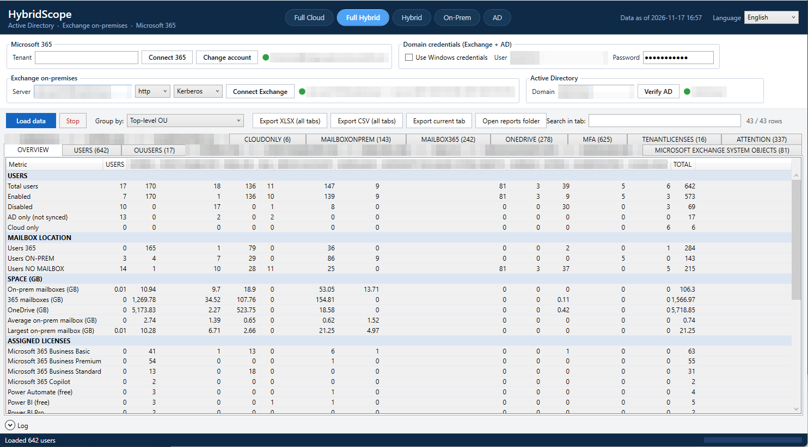
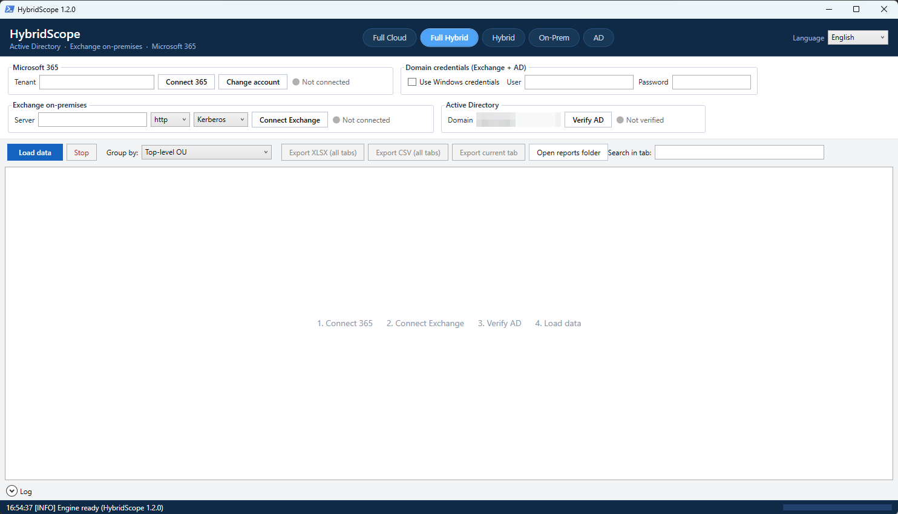
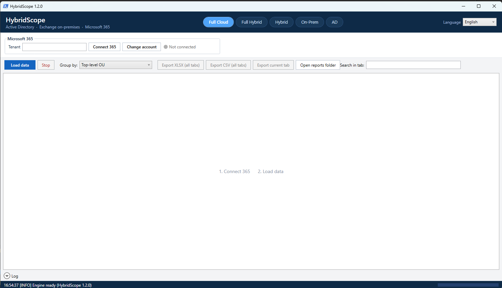
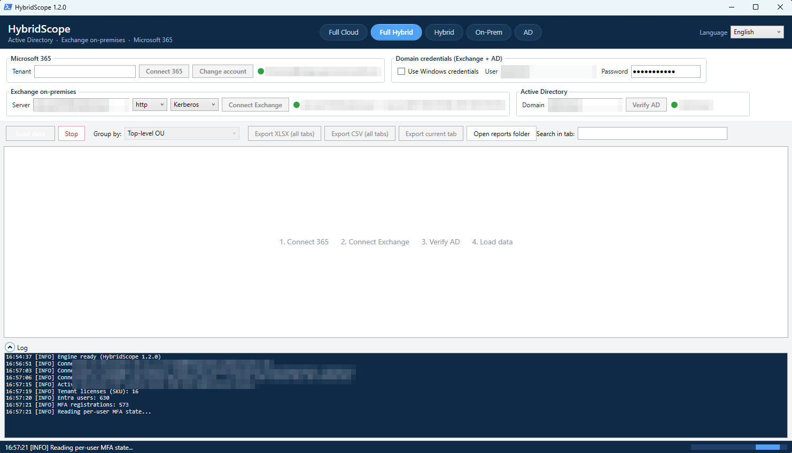

<div align="center">

# HybridScope

**Una sola vista sulle identità ibride: Active Directory + Exchange on-premises + Microsoft 365.**

Chi è on-prem e chi è già nel cloud, quanto spazio occupa ogni mailbox, chi ha licenza, chi ha l'MFA, chi non accede da mesi: tutto in una finestra, esportabile in Excel.

[](https://github.com/sponsors/Thonno)
[](https://buymeacoffee.com/aascione956)
[](https://github.com/Thonno/hybridscope/stargazers)


[English](README.md) · **Italiano**



</div>

---

## Indice

- [Funzionalità](#funzionalità)
- [Screenshot](#screenshot)
- [Requisiti](#requisiti)
- [Avvio rapido](#avvio-rapido)
- [Uso dell'interfaccia](#uso-dellinterfaccia)
- [Tab e colonne](#tab-e-colonne)
- [Configurazione (config.json)](#configurazione-configjson)
- [Permessi](#permessi)
- [Report pianificati (-Auto)](#report-pianificati--auto)
- [Risoluzione problemi](#risoluzione-problemi)
- [FAQ](#faq)
- [Roadmap](#roadmap)
- [Sostieni il progetto](#sostieni-il-progetto)
- [Licenza](#licenza)

## Funzionalità

- **Interfaccia stile RVTools**: ogni insieme di dati nel suo tab, ricerca che filtra il tab corrente, colonne ordinabili, copia con intestazioni.
- **Tre fonti in un unico report**:
  - **Active Directory**: utenti, OU, stato, ultimo logon, ultimo cambio password
  - **Exchange Server on-premises**: mailbox, dimensione, elementi, database, quota, ultimo accesso, e le mailbox remote già migrate
  - **Microsoft 365 (Microsoft Graph)**: licenze, ultimo accesso, mailbox Exchange Online, OneDrive, registrazione MFA e metodi, stato MFA per-user, licenze acquistate e libere
- **Posizione della mailbox affidabile**: `ON-PREM` / `365` / `NO MAILBOX` arriva da Exchange (`Get-Mailbox`, `Get-RemoteMailbox`) e da Graph (`provisionedPlans`), mai dallo spazio occupato.
- **Stato MFA reale**: se è registrato almeno un metodo, quali metodi, quello predefinito e lo stato per-user legacy.
- **Panoramica** per gruppo (OU) con totali, più una lista **Da attenzionare**:
  - mailbox on-prem da migrare, ordinate per dimensione
  - utenti licenziati senza MFA
  - licenze assegnate ad account disabilitati
  - account inattivi
  - account AD non sincronizzati
- **Export**: XLSX formattato (tutti i tab) o CSV, oppure solo il tab corrente con il filtro applicato.
- **Funziona anche da PC fuori dominio**: credenziali Windows oppure utente e password di dominio inseriti a mano, con Kerberos.
- **Modalità di infrastruttura**: *Full Cloud*, *Full Hybrid*, *Hybrid*, *On-Prem* o *AD*, selezionabili con un clic. L'app mostra e unisce solo le fonti che hai.
- **Raggruppamento in tab** scelto dalla finestra: OU di primo livello, OU che contiene l'utente, lista unica oppure regole personalizzate.
- **Indicatori di avanzamento**: Connetti 365 › Connetti Exchange › Verifica AD › Carica dati diventano verdi con una ✓ quando sono completati, gialli durante l'esecuzione e rossi in caso di errore.
- Pulsante **Cambia account** per disconnettersi da Microsoft 365 e cancellare l'accesso salvato, e pulsante **Interrompi** per fermare un caricamento in corso.
- **Modalità `-Auto`**: accesso con certificato per report pianificati. Mantiene una copia `HybridScope_LATEST.xlsx` e uno storico dell'andamento (utenti on-prem, spazio, % MFA).
- Interfaccia in **italiano / inglese**.
- **Sola lettura**: HybridScope non modifica nulla in AD, Exchange o Microsoft 365.

## Screenshot

**Panoramica**: conteggi per OU / gruppo, posizione delle mailbox, spazio, licenze, MFA e inattività a colpo d'occhio.


**Utenti**: una riga per utente, con i dati di AD, Exchange e Microsoft 365 uniti. Cerca, ordina, esporta.


**Modalità di infrastruttura**: un clic e la finestra mostra solo le connessioni che servono.

| Full Hybrid | Full Cloud |
|---|---|
|  |  |
| **Hybrid** | **On-Prem** |
|  |  |
| **AD** | **Connesso, caricamento in corso** |
|  |  |

<sub>I dati sensibili (utenti, domini, server, nomi delle OU) sono sfocati.</sub>

## Requisiti

| | |
|---|---|
| Sistema | Windows 10 / 11 o Windows Server 2016+ |
| PowerShell | **Windows PowerShell 5.1**, già incluso in Windows |
| Moduli | `Microsoft.Graph.Authentication`, `ImportExcel`, `ActiveDirectory` (RSAT). All'avvio HybridScope propone di installare quelli mancanti. |
| Rete | HTTPS verso Microsoft 365; HTTP 80 (WinRM) verso il server Exchange; 9389 (ADWS) verso un domain controller |
| Exchange | Exchange Server 2013 / 2016 / 2019 / SE. Facoltativo: senza, ottieni solo AD + Microsoft 365. |
| Microsoft 365 | Ultimo accesso e report di registrazione MFA richiedono **Entra ID P1** (incluso in Business Premium, E3, E5). Senza P1, HybridScope passa a un metodo più lento e lo segnala. |

## Avvio rapido

1. **Scarica** l'ultima release (o fai `git clone`) in una cartella locale, es. `C:\HybridScope`. Evita OneDrive e Desktop.
2. **Abilita gli script locali** una volta sola. Da PowerShell:
   ```powershell
   Set-ExecutionPolicy -Scope CurrentUser RemoteSigned
   Get-ChildItem C:\HybridScope -Recurse | Unblock-File
   ```
3. **Avvia** con doppio clic su **`Start-HybridScope.cmd`**, oppure da PowerShell:
   ```powershell
   cd C:\HybridScope
   .\HybridScope.ps1
   ```
4. Se te lo propone, lascia che installi i moduli mancanti. Per `ActiveDirectory` si apre una finestra PowerShell visibile che chiede la conferma di amministratore.

### Facoltativo: creare un .exe

```powershell
.\tools\Build-Exe.ps1
```
Crea `HybridScope.exe` nella cartella principale con [PS2EXE](https://github.com/MScholtes/PS2EXE) e installa PS2EXE se manca. L'exe deve restare nella stessa cartella di `tools\` e `config.json`.

> ⚠️ Gli antivirus e le sandbox (Defender, Bitdefender...) segnalano spesso gli exe creati con PS2EXE come falsi positivi. Firma l'exe con un certificato di code signing (il comando viene mostrato alla fine della build), oppure usa semplicemente `Start-HybridScope.cmd`.

Al primo avvio viene creato `config.json` accanto allo script. `config.sample.json` mostra tutte le opzioni.

## Uso dell'interfaccia

0. **Infrastruttura**: in alto nella finestra clicca il pulsante che corrisponde al tuo ambiente: *Full Cloud*, *Full Hybrid*, *Hybrid*, *On-Prem* o *AD*. Vengono mostrati solo i riquadri che servono.
1. **Microsoft 365**: inserisci il tenant se vuoi (`contoso.onmicrosoft.com`), poi **Connetti 365**. Si apre il browser. La prima volta un amministratore deve dare il consenso ai permessi, tutti in sola lettura.
2. **Credenziali di dominio**:
   - lascia **Usa credenziali Windows** su un PC nel dominio;
   - altrimenti togli la spunta e scrivi utente e password: `mario@contoso.local`, `CONTOSO\mario` oppure solo `mario`, e in quel caso `@dominio` viene aggiunto in automatico.

   Valgono sia per Exchange sia per AD. L'utente viene ricordato, la password mai.

   Sei entrato in Microsoft 365 con l'account sbagliato? Premi **Cambia account**: disconnette e cancella l'accesso salvato, poi **Connetti 365** chiede di nuovo l'account. L'accesso non viene mai conservato tra una sessione e l'altra.
3. **Exchange on-premises**: inserisci il nome **interno** di un server Exchange (es. `exch01.contoso.local`) e scegli la modalità:
   - `http` + `Kerberos`: consigliata, nessun certificato
   - `https`: solo con un certificato valido per quel nome
   - `local`: se HybridScope gira direttamente sul server Exchange

   Poi premi **Connetti Exchange**.
4. **Active Directory**: controlla il dominio e premi **Verifica AD**.
5. Scegli **Raggruppa per**:
   - *OU di primo livello*: la prima OU sotto il dominio, es. `Vendite`
   - *OU di appartenenza*: l'OU che contiene direttamente l'utente, es. `Interni` o `Esterni`; di solito è la più utile
   - *Nessun raggruppamento*: una lista unica
   - *Regole personalizzate*: `GroupRules` in `config.json`

   Non devi mai mappare le OU a mano: il raggruppamento è automatico e la scelta viene ricordata.
6. Premi **Carica dati**. L'avanzamento compare nel pannello **Log**; qualche centinaio di utenti richiede pochi minuti. **Interrompi** ferma il caricamento; attende la fine della richiesta in corso.
7. Cerca, ordina ed **esporta**.

La lingua si cambia dal menu in alto a destra (serve un riavvio).

### Modalità di infrastruttura

Scegli la tua infrastruttura con i pulsanti in alto nella finestra. Riquadri di connessione, tab, colonne e panoramica si adattano alle fonti che hai. Per cambiare basta un clic: la scelta non è legata ai dati.

| Pulsante | Fonti | Cosa ottieni |
|---|---|---|
| **Full Cloud** | Microsoft 365 | Utenti, licenze, mailbox Exchange Online, OneDrive, MFA, ultimo accesso |
| **Full Hybrid** | Microsoft 365 + Exchange on-prem + AD | Tutto: posizione on-prem o 365, mailbox su entrambi i lati, MFA, licenze, dati AD |
| **Hybrid** | Microsoft 365 + AD | Utenti AD uniti ai loro account cloud: licenze, Exchange Online, OneDrive, MFA |
| **On-Prem** | Exchange on-prem + AD | Utenti AD con le loro mailbox on-prem: dimensione, database, quota, ultimo accesso, inattività |
| **AD** | Active Directory | Utenti, OU, stato, ultimo logon, età della password, inattività |

Per i report pianificati (`-Auto`) la modalità si imposta con `Mode` in `config.json`.

## Tab e colonne

| Tab | Contenuto |
|---|---|
| **PANORAMICA** | Conteggi per gruppo e **TOTALE**: utenti, posizione mailbox, spazio (GB), licenze, MFA, inattività |
| **UTENTI** | Tutti gli utenti, una riga ciascuno |
| *un tab per gruppo* | Utenti di ogni OU / gruppo (vedi `GroupBy` e `GroupRules`) |
| **ALTRI** | Utenti AD che non corrispondono a nessuna regola |
| **SOLO_CLOUD** | Utenti Entra senza account AD |
| **MAILBOX_ONPREM** | Mailbox on-prem: tipo, database, dimensione, elementi, eliminati, ultimo accesso, quota |
| **MAILBOX_365** | Mailbox Exchange Online dal report di utilizzo Microsoft |
| **ONEDRIVE** | Account OneDrive: spazio usato, quota, file, ultima attività |
| **MFA** | Ogni membro Entra: registrato, utilizzabile, metodo predefinito, metodi, stato per-user, SSPR, admin |
| **LICENZE_TENANT** | Licenze acquistate / assegnate / libere / sospese per SKU |
| **DA_ATTENZIONARE** | Lista di azioni: mailbox da migrare, licenziati senza MFA, licenziati disabilitati, account inattivi, account AD non sincronizzati |
| **STORICO** | Una riga per ogni esecuzione `-Auto`, per seguire l'andamento |

<details>
<summary><b>Colonne utente</b> (UTENTI e tab dei gruppi)</summary>

| Colonna | Descrizione |
|---|---|
| Gruppo | Gruppo / tab OU dell'utente |
| Nome, Cognome, AD_Username | Da AD (o da Entra per gli utenti solo cloud) |
| OU | Percorso dell'OU dell'utente, es. `CONTOSO\Vendite\Dipendenti` |
| Stato | Abilitato / Disabilitato |
| AD_UltimoLogon | `lastLogonTimestamp`, replicato, preciso a circa 14 giorni |
| M365_UltimoAccesso | Ultimo accesso interattivo o non interattivo |
| Licenze | Nomi leggibili delle licenze (vedi `LicenseNames`) |
| Mailbox365_MB / MailboxOnPrem_MB / OneDrive_MB | Spazio usato in MB (2 decimali). Vuoto se Microsoft non riporta la dimensione |
| UltimoCambioPassword | Ultimo cambio password (AD) |
| **Location** | `365`, `ON-PREM` o `NO MAILBOX`; vedi sotto |
| TipoMailbox | `UserMailbox`, `SharedMailbox`, `RemoteUserMailbox`, `Exchange Online`... |
| FonteMailbox | Da dove arriva l'informazione sulla posizione |
| MFA_Stato | Configurato / Non configurato / Non presente in Entra |
| MFA_MetodoDefault, MFA_Metodi | Metodo MFA predefinito e tutti i metodi registrati |
| MFA_PerUser | MFA per-user legacy: `disabled` / `enabled` / `enforced` |
| UPN | User principal name di Microsoft 365 |
| Origine | AD sincronizzato / Solo AD / Solo cloud / Guest |
| Note | Anomalie, es. "Licenziato senza MFA" o "Password senza scadenza" |
</details>

**Come viene decisa la Location:**
1. Esiste una mailbox su Exchange on-prem (`Get-Mailbox`): **ON-PREM**
2. Esiste una `RemoteMailbox` su Exchange on-prem, cioè la mailbox è stata migrata: **365**
3. Exchange Online è attivo per l'utente (Graph `provisionedPlans`) oppure l'utente compare nel report di utilizzo: **365**
4. Nessuno dei casi precedenti: **NO MAILBOX**

## Configurazione (config.json)

| Chiave | Default | Descrizione |
|---|---|---|
| `Language` | di sistema | `en` o `it` |
| `Mode` | `FullHybrid` | `Cloud`, `FullHybrid`, `Hybrid`, `OnPrem` o `AD`. Modalità di partenza della finestra e modalità usata da `-Auto` |
| `TenantId` | *(vuoto)* | Dominio o ID del tenant. Vuoto vuol dire il tenant dell'account con cui accedi |
| `AuthMode` | `Interactive` | `Interactive` (browser) oppure `Certificate` (per `-Auto`) |
| `ClientId`, `CertificateThumbprint` | | Impostati da `tools\New-HybridScopeApp.ps1` |
| `IncludePerUserMfaState` | `true` | Legge lo stato MFA per-user legacy (una chiamata Graph per utente) |
| `DomainFqdn` | `%USERDNSDOMAIN%` | Dominio AD, es. `contoso.local`. Vuoto salta AD |
| `SearchBase` | *(vuoto)* | Limita AD a una OU, es. `OU=Azienda,DC=contoso,DC=local` |
| `UseWindowsCredentials`, `DomainUser` | `true`, vuoto | Ultimi valori usati nell'interfaccia. La password non viene mai salvata |
| `ExchangeServer` | *(vuoto)* | FQDN interno di un server Exchange. Vuoto salta Exchange |
| `ExchangeProtocol` | `http` | `http`, `https` o `local` |
| `ExchangeAuth` | `Kerberos` | `Kerberos`, `Negotiate` o `Basic` |
| `ExchangeSkipCertCheck` | `false` | Salta i controlli del certificato con `https` |
| `OutputFolder` | `Documenti\HybridScope` | Report, `history.csv` e log |
| `RetentionDays` | `90` | `-Auto` cancella report e log più vecchi (0 = mai) |
| `InactiveDays` | `90` | Soglia di inattività |
| `PasswordAgeDays` | `365` | Soglia password vecchia |
| `LicenseFilter` | `All` | `All` mostra tutti gli SKU (quelli sconosciuti con il nome tecnico); `MappedOnly` mostra solo quelli in `LicenseNames` |
| `LicenseNames` | SKU comuni | `"SKU_PART_NUMBER": "Nome leggibile"`. Aggiungi o rinomina liberamente |
| `GroupBy` | `TopLevelOU` | `TopLevelOU`, `ParentOU`, `None` (gruppo unico) oppure `Rules` (usa `GroupRules`). Selezionabile anche dalla finestra |
| `GroupRules` | `[]` | Usato solo con `GroupBy = Rules`. `[{ "Group": "DIPENDENTI", "Match": "OU=Dipendenti," }]`; vince il primo match sul DistinguishedName |
| `UnmappedGroup`, `CloudOnlyGroup` | `ALTRI`, `SOLO_CLOUD` | Nomi personalizzati per quei gruppi |
| `IncludeGuests` | `false` | Includi gli ospiti Entra |

Esempio di `GroupRules`:
```json
"GroupRules": [
  { "Group": "DISABILITATI", "Match": "OU=Utenti Disabilitati," },
  { "Group": "INTERNI",      "Match": "OU=Interni," },
  { "Group": "ESTERNI",      "Match": "OU=Esterni," }
]
```
> Lascia la virgola finale in `Match`: evita match parziali come `OU=InterniOld`.

Per mostrare **solo alcune licenze** con un nome a scelta, imposta `"LicenseFilter": "MappedOnly"` e lascia in `LicenseNames` solo quelle che ti interessano:
```json
"LicenseFilter": "MappedOnly",
"LicenseNames": {
  "O365_BUSINESS_PREMIUM":    "MICROSOFT BUSINESS STANDARD",
  "O365_BUSINESS_ESSENTIALS": "MICROSOFT BUSINESS BASIC",
  "TEAMS_ESSENTIALS_AAD":     "TEAMS ESSENTIALS",
  "SPB":                      "BUSINESS PREMIUM"
}
```

## Permessi

HybridScope **legge e basta**. Bastano i privilegi minimi; per l'uso quotidiano non servono Domain Admin né Global Admin.

| Sistema | Minimo |
|---|---|
| Active Directory | Un qualsiasi utente di dominio |
| Exchange on-premises | Gruppo di ruoli **View-Only Organization Management** e `RemotePowerShellEnabled = $true` |
| Microsoft 365 | **Global Reader**, più un consenso amministratore una tantum ai permessi qui sotto |

Permessi Microsoft Graph (delegati nell'interfaccia, applicativi per `-Auto`):
`User.Read.All`, `AuditLog.Read.All`, `Reports.Read.All`, `UserAuthenticationMethod.Read.All`, `Organization.Read.All`, `Policy.Read.All`.

## Report pianificati (-Auto)

1. **Crea l'app registration** con certificato. Va fatto una volta, da Global Admin, **con l'account che eseguirà il task**:
   ```powershell
   .\tools\New-HybridScopeApp.ps1 -TenantId contoso.onmicrosoft.com
   ```
   Crea il certificato, l'app con permessi in sola lettura e il consenso amministratore, e aggiorna `config.json` (`AuthMode = Certificate`).
2. **Registra il task giornaliero**, da PowerShell come amministratore:
   ```powershell
   .\tools\Register-HybridScopeTask.ps1 -RunAs CONTOSO\svc-hybridscope -At 06:40
   ```
3. Ogni esecuzione scrive in `OutputFolder`:
   - `HybridScope_<data>.xlsx`
   - `HybridScope_LATEST.xlsx`, sempre l'ultimo, comodo da condividere
   - `history.csv`, mostrato anche nel tab STORICO
   - `logs\`

Esecuzione manuale: `powershell -File .\HybridScope.ps1 -Auto`

## Risoluzione problemi

<details>
<summary><b>Collegato a Microsoft 365 con l'account sbagliato</b></summary>

Premi **Cambia account** per disconnetterti e cancellare l'accesso salvato, poi di nuovo **Connetti 365**. Se il browser sceglie da solo l'account sbagliato, nella pagina di accesso Microsoft scegli *Usa un altro account*, oppure esci prima da quell'account nel browser.
</details>

<details>
<summary><b>"WorkgroupCannotUseKerberos" / "Impossibile utilizzare l'autenticazione Kerberos con credenziali implicite"</b></summary>

Il PC non è nel dominio. Togli **Usa credenziali Windows** e inserisci `utente@dominio.local`. Il PC deve risolvere il dominio tramite DNS interno o VPN: `nslookup -type=SRV _kerberos._tcp.contoso.local`.
</details>

<details>
<summary><b>"Nome utente o password non corretta" verso Exchange</b></summary>

Controlla il sAMAccountName esatto, per esempio `m.rossi` invece di `mrossi`, e usa il formato `utente@dominio.local`. Prova fuori da HybridScope:

```powershell
$cred = Get-Credential utente@contoso.local
$s = New-PSSession -ConfigurationName Microsoft.Exchange -ConnectionUri http://exch01.contoso.local/PowerShell/ -Authentication Kerberos -Credential $cred
Invoke-Command -Session $s -ScriptBlock { Get-ExchangeServer }
```
</details>

<details>
<summary><b>Il browser chiede un certificato su https://server/powershell</b></summary>

È normale: `/PowerShell` è un endpoint WinRM, non una pagina web. Usa `http` + `Kerberos` con il nome interno del server.
</details>

<details>
<summary><b>Le dimensioni di mailbox 365 / OneDrive sono vuote</b></summary>

I report di utilizzo sono anonimizzati. Nell'interfaccia di amministrazione di Microsoft 365 vai in **Impostazioni > Impostazioni organizzazione > Report** e togli la spunta a *Visualizza nomi utente, gruppi e siti nascosti in tutti i report*. I report possono anche essere in ritardo di 24-48 ore.
</details>

<details>
<summary><b>Modulo ActiveDirectory: errore 0x800f0954</b></summary>

Il WSUS blocca le funzionalità su richiesta. Installa *RSAT: Strumenti di Servizi di dominio Active Directory* da **Impostazioni > Sistema > Funzionalità facoltative**, oppure chiedi all'IT di consentirlo. HybridScope non modifica le impostazioni di Windows Update.
</details>

<details>
<summary><b>L'antivirus segnala l'exe</b></summary>

Gli eseguibili creati con PS2EXE (`tools\Build-Exe.ps1`) vengono spesso segnalati per errore (falsi positivi). Usa `Start-HybridScope.cmd`, che avvia lo script in chiaro con Windows PowerShell, oppure firma l'exe con il certificato di code signing aziendale.
</details>

<details>
<summary><b>"l'esecuzione di script è disabilitata" / "non è firmato digitalmente"</b></summary>

```powershell
Set-ExecutionPolicy -Scope CurrentUser RemoteSigned
Get-ChildItem C:\HybridScope -Recurse | Unblock-File
```
</details>

## FAQ

**Modifica qualcosa?** No. Tutte le chiamate sono in sola lettura. L'unica eccezione è l'installazione dei moduli PowerShell mancanti, e solo se accetti.

**Dove vengono inviati i miei dati?** Da nessuna parte. HybridScope comunica solo con il tuo AD, il tuo server Exchange e Microsoft Graph. I report restano sul tuo disco.

**Funziona senza Microsoft 365, con solo Exchange 2016/2019 e AD?** Sì: usa la modalità **On-Prem**.

**Solo Microsoft 365, oppure Microsoft 365 + AD senza Exchange?** Sì: usa la modalità **Full Cloud** o **Hybrid**.

**Solo Active Directory?** Sì: usa la modalità **AD**.

## Roadmap

- [ ] Panoramica cliccabile: doppio clic su un numero per aprire un tab con esattamente quegli utenti
- [ ] Scheda utente: doppio clic su un utente per vedere insieme AD, mailbox, OneDrive, MFA e licenze
- [ ] Mailbox condivise / sale e liste di distribuzione
- [ ] Report HTML
- [ ] Altre lingue (le PR sono benvenute: i testi sono in `$global:HS_Str` all'inizio di `HybridScope.ps1`)

## Sostieni il progetto

Se HybridScope ti fa risparmiare tempo, puoi sostenerne lo sviluppo:

[](https://github.com/sponsors/Thonno)
[](https://buymeacoffee.com/aascione956)
[](https://github.com/Thonno/hybridscope/stargazers)

Issue e pull request sono benvenute. Per modifiche importanti apri prima una issue.

## Licenza

[MIT](LICENSE). HybridScope è un progetto indipendente e non è affiliato, approvato o sponsorizzato da Microsoft. Microsoft 365, Exchange, Entra ID e Active Directory sono marchi del gruppo Microsoft.
