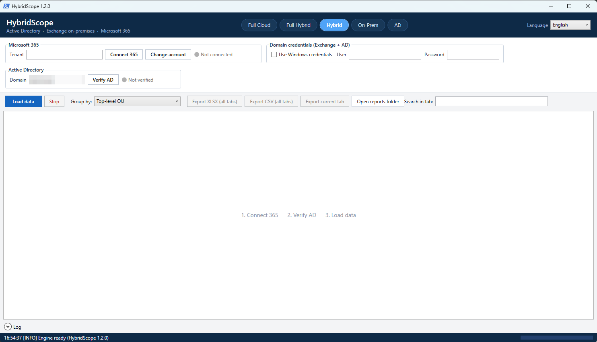
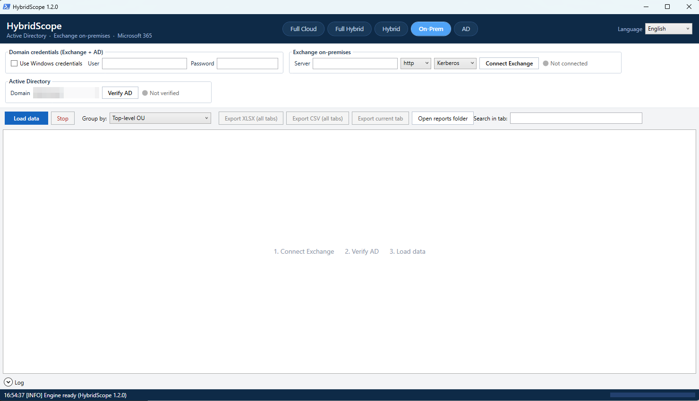
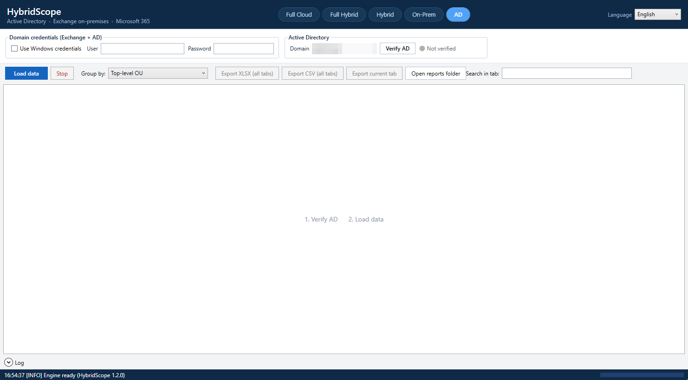

<div align="center">


# HybridScope

**Una sola vista sulle identità ibride e sui loro PC: Active Directory + Exchange on-premises + Microsoft 365 + Microsoft Defender.**

Chi è on-prem e chi è già nel cloud, quanto spazio occupa ogni mailbox, chi ha licenza, chi ha l'MFA, chi non accede da mesi e quali PC hanno vulnerabilità da sistemare: tutto in una finestra, esportabile in Excel.

[](https://github.com/sponsors/Thonno)
[](https://buymeacoffee.com/aascione956)
[](https://github.com/Thonno/hybridscope/stargazers)


[English](README.md) · **Italiano** · [Sito web](https://thonno.github.io/hybridscope/)


</div>

---

## Indice

1. [Cosa fa HybridScope](#cosa-fa-hybridscope)
2. [Avvio rapido](#avvio-rapido)
3. [**Microsoft Defender (sicurezza)**](#microsoft-defender-sicurezza) ← configurazione una tantum necessaria per i tab di sicurezza
4. [Uso dell'interfaccia](#uso-dellinterfaccia)
5. [Riga di comando e report pianificati](#riga-di-comando-e-report-pianificati)
6. [Tab e colonne](#tab-e-colonne)
7. [Configurazione (config.json)](#configurazione-configjson)
8. [Permessi](#permessi)
9. [Risoluzione problemi](#risoluzione-problemi)
10. [FAQ](#faq) · [Roadmap](#roadmap) · [Sostieni il progetto](#sostieni-il-progetto) · [Licenza](#licenza)

---

## Cosa fa HybridScope

Uno strumento PowerShell gratuito per Windows, con una finestra in stile RVTools. **Legge e basta**: non modifica nulla in AD, Exchange, Microsoft 365 o Defender.

| Fonte | Cosa legge |
|---|---|
| **Active Directory** | Utenti, OU, abilitati / disabilitati, ultimo logon, ultimo cambio password, gruppi |
| **Exchange Server on-premises** | Mailbox: dimensione, elementi, database, quota, ultimo accesso; mailbox remote già migrate |
| **Microsoft 365** (Microsoft Graph) | Licenze, ultimo accesso, Exchange Online, OneDrive, registrazione e metodi MFA, MFA per-user |
| **Microsoft Defender** (Business / Endpoint) | Per gli utenti con licenza Defender: i loro PC, rischio, antivirus, vulnerabilità (CVE), KB mancanti, software da aggiornare o fuori supporto, configurazioni deboli |

Cosa ne ottieni:

- **Posizione della mailbox affidabile**: `ON-PREM` / `365` / `NO MAILBOX` da Exchange e Graph, mai dedotta dalla dimensione.
- **Stato MFA reale**: registrato o no, quali metodi, quello predefinito, lo stato per-user legacy.
- **Sicurezza per utente e PC** (Defender): cosa aggiornare, su quale PC, prima le vulnerabilità sfruttabili. Vedi [Microsoft Defender](#microsoft-defender-sicurezza).
- **Controllo sincronizzazione AD ↔ Entra ID**: `ImmutableId` rotti, account che alla prossima sincronizzazione faranno soft-match o andranno in conflitto, errori di provisioning.
- **Panoramica** per OU con totali e una lista **Da attenzionare**: mailbox da migrare, licenziati senza MFA, licenze su account disabilitati, account inattivi o non sincronizzati, problemi di sincronizzazione, vulnerabilità sfruttabili.
- **Scheda utente**: doppio clic su un utente per vedere in una finestra AD, mailbox, OneDrive, MFA, licenze, gruppi e ruoli; per chi ha un PC in Defender, un secondo pannello elenca cosa sistemare su ogni PC (KB, aggiornamenti software, software fuori supporto, configurazioni deboli) con gravità ed exploit.
- **Export** in Excel formattato o CSV: tutto, un preset o solo le colonne che spunti. **Apri un report salvato** in seguito senza collegarti a niente.
- **Report pianificati** (`-Auto`) e **riga di comando** (`-Only MFA`, `-PassThru`...).
- **Cinque modalità di infrastruttura** (Full Cloud, Full Hybrid, Hybrid, On-Prem, AD), funziona da PC fuori dominio, interfaccia in italiano / inglese.

<details>
<summary><b>Screenshot</b></summary>

**Utenti**: una riga per utente, AD + Exchange + Microsoft 365 uniti.


| Full Hybrid | Full Cloud |
|---|---|
|  |  |
| **Hybrid** | **On-Prem** |
|  |  |
| **AD** | **Connesso, caricamento in corso** |
|  |  |

<sub>I dati sensibili (utenti, domini, server, nomi delle OU) sono sfocati.</sub>
</details>

---

## Avvio rapido

**Requisiti**: Windows 10 / 11 o Windows Server 2016+, Windows PowerShell 5.1 (già incluso in Windows). All'avvio HybridScope propone di installare i moduli `Microsoft.Graph.Authentication`, `ImportExcel` e `ActiveDirectory` (RSAT). Ultimo accesso e report MFA richiedono **Entra ID P1** (incluso in Business Premium, E3, E5); senza, HybridScope usa un metodo più lento.

1. **Scarica** l'[ultima release](https://github.com/Thonno/hybridscope/releases/latest) ed estraila in una cartella locale, es. `C:\HybridScope` (non OneDrive o Desktop).
2. **Abilita gli script locali**, una volta sola, da PowerShell:
   ```powershell
   Set-ExecutionPolicy -Scope CurrentUser RemoteSigned
   Get-ChildItem C:\HybridScope -Recurse | Unblock-File
   ```
3. **Avvia**: doppio clic su **`Start-HybridScope.cmd`** (oppure `.\HybridScope.ps1` da PowerShell). Accetta l'installazione dei moduli mancanti.
4. Scegli l'**infrastruttura** in alto, **collegati** (Microsoft 365, Exchange, AD) e premi **Carica dati**. Guida passo passo: [Uso dell'interfaccia](#uso-dellinterfaccia).
5. Vuoi i **tab di sicurezza** (Defender)? Fai prima la [configurazione una tantum](#microsoft-defender-sicurezza).

`config.json` viene creato accanto allo script al primo avvio; `config.sample.json` elenca tutte le opzioni.

---

## Microsoft Defender (sicurezza)

> **Serve una configurazione una tantum.** I tab di sicurezza hanno bisogno di due cose che HybridScope non può fare da solo: **i PC devono essere registrati (onboarding) in Microsoft Defender** e un amministratore deve **registrare l'app HybridScope** in Entra ID (5 minuti, con lo script o a mano). Senza, HybridScope funziona come sempre, solo senza i tab di sicurezza.

### Cosa ottieni

Con la casella **Defender** spuntata, **Carica dati** legge anche **Microsoft Defender for Business / Defender for Endpoint** (incluso in Microsoft 365 Business Premium, E3 / E5 e nei componenti aggiuntivi Defender). Compaiono solo gli **utenti con licenza Defender**: gli utenti con altre licenze (es. Teams Essentials, Business Standard) e i PC usati solo da loro restano fuori.

| Tab | Contenuto |
|---|---|
| **SICUREZZA** | Una riga per utente con licenza e PC: sistema operativo e build, ultimo contatto, stato del sensore, livello di rischio ed esposizione, modalità e aggiornamento dell'antivirus, avvisi aperti, vulnerabilità per gravità, quante sono sfruttabili, KB mancanti, software da aggiornare, software fuori supporto, configurazioni deboli, note. Gli utenti senza PC in Defender hanno una riga che lo dice |
| **VULNERABILITÀ** | Una riga per PC e CVE (da `DefenderMinSeverity`, default High): CVSS, exploit (pubblico / verificato / exploit kit), software e versione, **intervento** (KB da installare, oppure aggiornamento del software con la versione consigliata). Prima quelle sfruttabili |
| **INTERVENTI_SICUREZZA** | La lista delle cose da fare, in ordine di priorità: ogni KB, aggiornamento software, software da sostituire e configurazione debole, con quanti PC e CVE risolve e quali PC |
| **DISPOSITIVI_NON_ASSEGNATI** | Facoltativo (`DefenderUnassignedDevices`): dispositivi registrati non collegati a un utente con licenza, con il motivo. Utile per verificare la configurazione |

In più: una sezione **SICUREZZA (DEFENDER)** nella PANORAMICA, due categorie in DA_ATTENZIONARE (vulnerabilità sfruttabili o critiche; licenza Defender senza PC), una sezione per ogni PC nella scheda utente, e il punteggio di esposizione / Secure Score dei dispositivi nell'intestazione del report.

### Prima di iniziare: lista di controllo

| # | Cosa | Chi | Come verificarlo |
|---|---|---|---|
| 1 | Gli utenti hanno una licenza che include Defender (Business Premium, E5, Defender for Business / Endpoint) | — | Il log mostra *N utenti con licenza Defender* |
| 2 | **I PC sono registrati in Defender** | IT, una volta per PC | https://security.microsoft.com > **Asset** > **Dispositivi**: il PC deve risultare *Onboarded* |
| 3 | L'**app HybridScope** è registrata in Entra ID | Un Global Administrator, una volta per tenant | Entra > **Registrazioni app** > *HybridScope* |
| 4 | Chi usa HybridScope ha un ruolo Defender, es. **Lettore sicurezza** | Un Global Administrator, una volta per utente | Entra > **Ruoli e amministratori** |

**Sul passo 2 (onboarding).** Defender conosce solo i PC dove il suo sensore è attivo. La licenza da sola non basta, e **un PC protetto da un altro antivirus (es. Bitdefender) non si registra da solo**. Registralo da https://security.microsoft.com > **Impostazioni** > **Endpoint** > **Onboarding** (script locale per pochi PC, Criteri di gruppo, Configuration Manager o Intune). L'altro antivirus può restare: su un PC registrato Microsoft Defender Antivirus passa in *modalità passiva* e Defender raccoglie comunque vulnerabilità, software e configurazioni. HybridScope mostra allora l'antivirus come *Passive*.

### Come funziona l'accesso

Microsoft fa leggere Defender ai programmi solo tramite una **registrazione app** del vostro tenant (l'app generica usata da *Connetti 365* non può). Per questo HybridScope usa un'app chiamata **HybridScope**, registrata **una volta sola per tutto il tenant**:

- **nell'interfaccia: accesso dal browser.** Quando premi **Carica dati** con **Defender** spuntato, il browser chiede di accedere con **il tuo account** (di solito si chiude da solo, perché sei già autenticato). Niente certificati, niente segreti, niente da copiare tra i PC. Ognuno vede solo quello che gli consente il suo ruolo Defender;
- **nei report pianificati (`-Auto`): certificato.** Non c'è nessuno che possa fare l'accesso, quindi la stessa app usa un certificato (vedi [Report pianificati](#report-pianificati--auto)). Non serve se usi solo l'interfaccia.

L'app ha solo permessi in **lettura**. Il suo ID (`ClientId`) non è un segreto: per usare HybridScope su altri PC copia `config.json`. Per revocare tutto basta cancellare l'app da Entra.

### Registrare l'app: opzione A, con lo script

Da PowerShell, come **Global Administrator**, nella cartella di HybridScope:

```powershell
.\tools\New-HybridScopeApp.ps1 -TenantId contoso.onmicrosoft.com -Defender
```

Fa l'accesso (browser), crea l'app **HybridScope** (o aggiorna quella già presente in `config.json`), aggiunge la piattaforma *Applicazioni per dispositivi mobili e desktop* con reindirizzamento `http://localhost`, i permessi delegati di Defender e il consenso amministratore, e scrive `TenantId`, `ClientId` e `Defender = true` in `config.json`. Non crea certificati. Se Defender non è mai stato aperto nel tenant, apri una volta https://security.microsoft.com da amministratore e rilancia lo script.

### Registrare l'app: opzione B, a mano

1. https://entra.microsoft.com, da Global Administrator > **Identità** > **Applicazioni** > **Registrazioni app** > **Nuova registrazione**.
2. **Nome** `HybridScope`; **Tipi di account supportati** *Account solo in questa directory organizzativa*; **URI di reindirizzamento**: piattaforma **Client pubblico/nativo (per dispositivi mobili e desktop)**, valore `http://localhost`. **Registra**.
3. In **Panoramica** copia **ID applicazione (client)** e **ID della directory (tenant)**.
4. **Autorizzazioni API** > **Aggiungi un'autorizzazione** > scheda **API usate dall'organizzazione** > **WindowsDefenderATP** > **Autorizzazioni delegate** > spunta `Machine.Read`, `User.Read.All`, `Vulnerability.Read`, `Software.Read`, `SecurityRecommendation.Read`, `Alert.Read`, `Score.Read` > **Aggiungi autorizzazioni**.
5. **Concedi consenso amministratore per &lt;tenant&gt;** > **Sì**. Tutte le autorizzazioni devono risultare *Concesso* (verde).
6. Nel `config.json` di HybridScope (se non esiste ancora, avvia HybridScope una volta):
   ```json
   "TenantId": "contoso.onmicrosoft.com",
   "ClientId": "<ID applicazione (client)>",
   "Defender": true
   ```
7. Assegna a chi usa HybridScope un ruolo Defender, es. **Lettore sicurezza** (**Identità** > **Ruoli e amministratori**).

### Usarlo

**Interfaccia**: collegati come sempre, spunta **Defender** (accanto a *Connetti 365*), scegli **FULL** in *Contenuto export*, premi **Carica dati** e accedi quando il browser lo chiede. **Riga di comando**: `-Auto` legge Defender se `Defender = true` (con un certificato, vedi [Report pianificati](#report-pianificati--auto)).

Il log dice cosa è successo, per esempio:

```
Defender: 42 dispositivi registrati (3 rilevati in rete, non registrati)
Defender: 42 dispositivi -> 38 usati da utenti con licenza Defender, 2 solo da utenti senza, 0 solo da account non trovati in AD / Entra, 2 senza accessi interattivi
Defender: 55 utenti con licenza Defender, 38 dispositivi, 17 utenti senza dispositivo (95 s)
```

L'API Defender consente 100 chiamate al minuto e HybridScope legge gli utenti che accedono con una chiamata per PC: calcola circa 1 minuto ogni 90 PC.

### Come i PC vengono collegati agli utenti

- Defender registra **chi accede** a ogni PC registrato. HybridScope abbina quegli account agli utenti che legge già: `DOMINIO\utente` con l'account AD, `AzureAD\nome` (PC uniti a Entra ID) con l'UPN o il nome visualizzato. Se Defender non ha accessi per un PC unito a Entra ID, viene usato il suo **proprietario / utente registrato in Entra** (Graph `Device.Read.All`). Come ultima risorsa (`DefenderMatchByName`) l'utente viene dedotto dal **nome del PC** se contiene lo username o un cognome presente una sola volta (es. `NET-FBACCI`); quelle righe hanno una nota. **Non servono Intune né il join a Entra.**
- L'utente **principale** di un PC è quello con l'ultimo accesso interattivo; gli altri sono *Altro*. Gli accessi più vecchi di `DefenderDays` (default 30, contati dall'ultimo contatto del PC) non contano.
- Il **filtro per licenza** controlla i piani di servizio delle licenze dell'utente (`DefenderLicensePlans`: `MDE_SMB` = Defender for Business, `MDE_LITE` = Defender for Endpoint P1, `WINDEFATP` = P2), non il nome della licenza: componenti aggiuntivi ed E3 / E5 rientrano in automatico.

### Il tab SICUREZZA è vuoto o incompleto

| Cosa vedi | Perché | Cosa fare |
|---|---|---|
| *Nessun dispositivo in Defender con accessi di questo utente* per tutti, pochi dispositivi registrati nel log | I PC non sono registrati in Defender (es. protetti solo da un altro antivirus) | Registrali (lista di controllo, passo 2) |
| Log: *N senza accessi interattivi* | Defender non ha utenti che accedono a quei PC (registrati da poco: attendi qualche ora; server) e non c'è un proprietario Entra | Imposta `DefenderUnassignedDevices = true` (con HybridScope chiuso, altrimenti viene sovrascritto) e guarda la colonna *Account* in DISPOSITIVI_NON_ASSEGNATI; ricollegati con **Cambia account** per concedere `Device.Read.All` |
| Log: *N solo da utenti senza* | Quei PC sono usati da persone senza licenza Defender | Normale: restano fuori apposta |
| Log: *N solo da account non trovati in AD / Entra (…)* | I nomi degli accessi non corrispondono a nessun utente | Imposta `DefenderUnassignedDevices = true` per vedere gli account in DISPOSITIVI_NON_ASSEGNATI e apri una issue con un esempio |
| *accesso negato da Defender (403)* | Manca il ruolo Defender o il consenso amministratore | Lista di controllo, passi 3-4 |
| *ClientId mancante in config.json* | App non registrata su questo PC | Opzione A o B, oppure copia `config.json` da un PC dove funziona |
| *Defender … non letto: …* | Quella parte non è disponibile con il vostro piano o i vostri permessi | Il resto del report viene scritto; niente da fare se quella parte non ti serve |
| AADSTS50011 (URI di reindirizzamento) nel browser | Manca `http://localhost` nell'app | Opzione B, passo 2 |

---

## Uso dell'interfaccia

1. **Infrastruttura**: clicca il tuo ambiente in alto nella finestra. Vengono mostrati solo i riquadri che servono.

   | Pulsante | Fonti | Cosa ottieni |
   |---|---|---|
   | **Full Cloud** | Microsoft 365 | Utenti, licenze, Exchange Online, OneDrive, MFA, ultimo accesso |
   | **Full Hybrid** | Microsoft 365 + Exchange on-prem + AD | Tutto: posizione on-prem o 365, mailbox su entrambi i lati, MFA, licenze, dati AD |
   | **Hybrid** | Microsoft 365 + AD | Utenti AD uniti ai loro account cloud |
   | **On-Prem** | Exchange on-prem + AD | Utenti AD con le loro mailbox on-prem |
   | **AD** | Active Directory | Utenti, OU, stato, ultimo logon, età della password |

2. **Microsoft 365**: scrivi il tenant se vuoi (`contoso.onmicrosoft.com`), premi **Connetti 365** e accedi nel browser. La prima volta un amministratore dà il consenso ai permessi in sola lettura. Account sbagliato? **Cambia account**. Spunta **Defender** per i tab di sicurezza ([configurazione](#microsoft-defender-sicurezza)).
3. **Credenziali di dominio**: lascia **Usa credenziali Windows** su un PC nel dominio; altrimenti togli la spunta e scrivi `mario@contoso.local`, `CONTOSO\mario` oppure solo `mario`. Valgono per Exchange e AD; la password non viene mai salvata.
4. **Exchange on-premises**: nome interno di un server Exchange (es. `exch01.contoso.local`), `http` + `Kerberos` (consigliato), `https` solo con un certificato valido, `local` sul server Exchange stesso. **Connetti Exchange**.
5. **Active Directory**: controlla il dominio, **Verifica AD**.
6. **Raggruppa per**: *OU di primo livello*, *OU di appartenenza* (di solito la più utile), *Nessun raggruppamento* o *Regole personalizzate* (`GroupRules`). Nessuna mappatura delle OU a mano.
7. **Contenuto export** (cosa conterrà l'export), poi **Carica dati**. L'avanzamento compare nel **Log**; **Interrompi** ferma il caricamento.

   - **FULL**: tutti i tab e tutte le colonne (necessario per Defender).
   - **Un preset**: *Accessi e inattività*, *Licenze*, *Migrazione mailbox*, *Sicurezza MFA*, *Anagrafica*.
   - **Personalizzato**: **Colonne...** e spunta solo quello che serve; **Salva come preset...** lo conserva.
   - Opzioni: un foglio per gruppo, includi PANORAMICA, solo account abilitati.
   - **Leggi solo i dati necessari** (attiva di default): con un preset / Personalizzato vengono letti solo i dati che servono a quelle colonne, quindi il caricamento è molto più veloce; in alto compare **CARICAMENTO PARZIALE**.

8. **Lavora sui dati**: la ricerca filtra il tab corrente, colonne ordinabili, copia con intestazioni, **doppio clic su un utente** in qualsiasi tab per la scheda utente, **Esporta XLSX...** / **Esporta CSV...**, oppure solo il tab corrente.
9. **In seguito**: **File > Apri report** (Ctrl+O) o trascina un `.xlsx` / una cartella CSV sulla finestra per sfogliare un report salvato senza collegarti, es. l'`HybridScope_LATEST.xlsx` giornaliero.

Lingua: menu in alto a destra (serve un riavvio). **Aiuto > Cerca aggiornamenti** confronta con l'ultima release.

---

## Riga di comando e report pianificati

### Da PowerShell

Ogni esecuzione senza finestra usa `config.json`. Help completo: `Get-Help .\HybridScope.ps1 -Full`.

| Parametro | Cosa fa |
|---|---|
| `-Auto` | Report completo per la `Mode` configurata, scritto in `OutputFolder` (più `history.csv` e `HybridScope_LATEST.xlsx`). Include i tab Defender se `Defender = true` |
| `-Only <dataset>` | Un solo insieme di dati: `MFA`, `Licenses`, `Mailbox365`, `OneDrive`, `MailboxOnPrem` o `Sync`. Vengono contattate solo le fonti che servono |
| `-PassThru` | Oggetti invece di file: le righe di `-Only`, oppure una riga unita per utente (valori in inglese) |
| `-Mode <modalità>` | Sostituisce `Mode` solo per questa esecuzione: `Cloud`, `FullHybrid`, `Hybrid`, `OnPrem`, `AD` |
| `-ExportPreset <nome>` | `Full` (default), `Access`, `Licenses`, `Migration`, `MFA`, `Directory`, `Custom` o un tuo preset |
| `-Columns <lista>` | Solo queste colonne utente, in quest'ordine, es. `Username,AD_LastLogon,M365_LastSignIn` |
| `-ConfigPath <file>` | Un altro file di configurazione, es. uno per tenant |

Con `AuthMode = Interactive` (default) l'accesso nel browser si apre una volta (due con Defender); con `Certificate` nessuna richiesta. Exit code `0` = riuscito, `1` = errore (dettagli in `OutputFolder\logs`).

```powershell
# report completo adesso, come Carica dati con FULL
.\HybridScope.ps1 -Auto

# solo lo stato MFA, in Excel (AD ed Exchange non vengono toccati)
.\HybridScope.ps1 -Only MFA

# utenti senza MFA, direttamente in CSV
.\HybridScope.ps1 -Only MFA -PassThru | Where-Object MFA_Registered -eq 'No' | Export-Csv .\no-mfa.csv -NoTypeInformation

# cosa andrà storto alla prossima sincronizzazione AD -> Entra ID
.\HybridScope.ps1 -Only Sync -PassThru | Where-Object Category -notlike '0 *' | Format-Table Category, Username, UPN, Details -Wrap

# solo username, ultimo logon AD e ultimo accesso Microsoft 365
.\HybridScope.ps1 -Auto -Columns Username,AD_LastLogon,M365_LastSignIn

# solo Microsoft 365, senza modificare config.json
.\HybridScope.ps1 -Auto -Mode Cloud

# mailbox on-prem ancora da migrare, dalla più grande
.\HybridScope.ps1 -PassThru | Where-Object Location -eq 'ON-PREM' | Sort-Object MailboxOnPrem_MB -Descending
```

### Report pianificati (-Auto)

Un report giornaliero senza nessuno collegato richiede l'app HybridScope **con un certificato**.

1. **Certificato e permessi**, una volta, da Global Administrator, **collegato a Windows con l'account che eseguirà il task** (il certificato finisce nel suo archivio certificati):
   ```powershell
   .\tools\New-HybridScopeApp.ps1 -TenantId contoso.onmicrosoft.com
   ```
   Crea il certificato, lo aggiunge all'app HybridScope (quella di `config.json`, oppure una nuova), concede i permessi applicativi in sola lettura e imposta `AuthMode = Certificate`. Con `Defender = true` l'app riceve anche i permessi applicativi di Defender, così `-Auto` scrive anche i tab di sicurezza. Con `-Store LocalMachine` (da amministratore) il certificato è condivisibile tra gli account dello stesso PC.
2. **Task giornaliero**, da PowerShell come amministratore:
   ```powershell
   .\tools\Register-HybridScopeTask.ps1 -RunAs CONTOSO\svc-hybridscope -At 06:40
   ```
3. Ogni esecuzione scrive in `OutputFolder`: `HybridScope_<data>.xlsx` (con un preset `HybridScope_<preset>_<data>.xlsx`), `HybridScope_LATEST.xlsx` (sempre l'ultimo, comodo da condividere), `history.csv` (tab STORICO) e `logs\`.

Esecuzione manuale: `powershell -File .\HybridScope.ps1 -Auto`. L'interfaccia continua a usare l'accesso dal browser; il certificato serve solo a `-Auto`.

<details>
<summary><b>Facoltativo: creare un .exe</b></summary>

```powershell
.\tools\Build-Exe.ps1
```
Crea `HybridScope.exe` con [PS2EXE](https://github.com/MScholtes/PS2EXE) (installato se manca), con icona e versione di HybridScope. Deve restare accanto a `tools\` e `config.json`. L'exe **contiene** lo script: va ricreato dopo ogni aggiornamento. Gli antivirus segnalano spesso gli exe PS2EXE come falsi positivi: firmalo, oppure usa semplicemente `Start-HybridScope.cmd`.
</details>

---

## Tab e colonne

| Tab | Contenuto |
|---|---|
| **PANORAMICA** | Conteggi per gruppo e **TOTALE**: utenti, posizione mailbox, spazio (GB), licenze, MFA, inattività, sicurezza |
| **UTENTI** | Tutti gli utenti, una riga ciascuno |
| *un tab per gruppo* | Utenti di ogni OU / gruppo (`GroupBy`, `GroupRules`) |
| **ALTRI** / **SOLO_CLOUD** | Utenti AD che non corrispondono a nessuna regola / utenti Entra senza account AD |
| **MAILBOX_ONPREM** | Mailbox on-prem: tipo, database, dimensione, elementi, eliminati, ultimo accesso, quota |
| **MAILBOX_365** | Mailbox Exchange Online (report di utilizzo Microsoft) |
| **ONEDRIVE** | OneDrive: spazio usato, quota, file, ultima attività |
| **MFA** | Ogni membro Entra: registrato, utilizzabile, metodo predefinito, metodi, stato per-user, SSPR, admin |
| **LICENZE_TENANT** | Licenze acquistate / assegnate / libere / sospese per SKU |
| **SYNC** | Controllo della sincronizzazione AD ↔ Entra ID (modalità con AD e Microsoft 365) |
| **SICUREZZA**, **VULNERABILITÀ**, **INTERVENTI_SICUREZZA** | Microsoft Defender, vedi [Microsoft Defender](#microsoft-defender-sicurezza) |
| **DA_ATTENZIONARE** | Cose da fare: mailbox da migrare, licenziati senza MFA, licenziati disabilitati, inattivi, non sincronizzati, problemi di sincronizzazione, vulnerabilità sfruttabili, licenza Defender senza PC |
| **STORICO** | Una riga per ogni esecuzione `-Auto`, per seguire l'andamento |

<details>
<summary><b>Colonne utente</b> (UTENTI e tab dei gruppi)</summary>

| Colonna | Descrizione |
|---|---|
| Gruppo | Gruppo / tab OU dell'utente |
| Nome, Cognome, AD_Username | Da AD (o da Entra per gli utenti solo cloud) |
| OU | Percorso dell'OU dell'utente, es. `CONTOSO\Vendite\Dipendenti` |
| Stato | Abilitato / Disabilitato |
| AD_UltimoLogon | `lastLogonTimestamp`, replicato, preciso a circa 14 giorni |
| M365_UltimoAccesso | Ultimo accesso interattivo o non interattivo |
| Licenze | Nomi leggibili delle licenze (`LicenseNames`) |
| Mailbox365_MB / MailboxOnPrem_MB / OneDrive_MB | Spazio usato in MB. Vuoto se Microsoft non lo riporta |
| UltimoCambioPassword | Ultimo cambio password (AD) |
| **Location** | `365`, `ON-PREM` o `NO MAILBOX` (sotto) |
| TipoMailbox, FonteMailbox | Tipo di mailbox e da dove arriva la posizione |
| MFA_Stato, MFA_MetodoDefault, MFA_Metodi | Configurato / Non configurato / Non presente in Entra, metodo predefinito e metodi registrati |
| MFA_PerUser | MFA per-user legacy: `disabled` / `enabled` / `enforced` |
| UPN, Origine | UPN Microsoft 365; AD sincronizzato / Solo AD / AD + cloud (non collegati) / Solo cloud / Guest |
| ProblemiSync, Note | Problemi di sincronizzazione (tab SYNC) e anomalie, es. "Licenziato senza MFA" |

**Location**: mailbox su Exchange on-prem → **ON-PREM**; `RemoteMailbox` (migrata) → **365**; Exchange Online attivo o presente nel report di utilizzo → **365**; altrimenti **NO MAILBOX**.
</details>

<details>
<summary><b>Categorie del controllo di sincronizzazione</b> (tab SYNC)</summary>

Il tab SYNC confronta AD ed Entra ID tramite l'**ancora di origine**, come fanno Entra Connect e Cloud Sync: `ms-DS-ConsistencyGuid` (o `objectGUID`) in AD, `onPremisesImmutableId` in Entra.

| Categoria | Cosa significa |
|---|---|
| 0 - Stato della sincronizzazione | Quando è girata l'ultima sincronizzazione; segnalata se più vecchia di `SyncStaleHours` o se è disattivata |
| 1 - ImmutableId diverso dall'ancora AD | Entra è collegato a un altro oggetto; di solito l'account AD è stato cancellato e ricreato |
| 2 - Account sincronizzato non trovato in AD | Sincronizzato dal dominio / OU che leggi, ma nessun account AD ha la sua ancora |
| 3 - Account cloud con ImmutableId residuo | Un account AD con quell'ancora lo prenderebbe in carico |
| 4 - Farà soft-match con un account cloud | Stesso UPN o SMTP primario: verranno uniti alla prima sincronizzazione |
| 5 - In conflitto con un account cloud | Stesso UPN / SMTP ma un altro `ImmutableId`: la sincronizzazione fallirà |
| 6 - Errore di provisioning in Entra | `proxyAddresses` duplicati, UPN... |
| 7 - UPN in Entra ripiegato su onmicrosoft.com | Il suffisso UPN di AD non è un dominio verificato |
| 8 - Stessa ancora su più account AD | Oggetti copiati o ripristinati |

Gli account di un altro dominio / foresta o fuori `SearchBase` non vengono segnalati come mancanti. Con un'ancora personalizzata (es. `employeeID`) le categorie 1 e 2 vengono saltate, con un avviso.
</details>

<details>
<summary><b>Colonne di sicurezza</b> (tab SICUREZZA)</summary>

| Colonna | Descrizione |
|---|---|
| Dispositivo, RuoloUtente | Nome del PC; *Principale* (ultimo accesso interattivo) o *Altro* |
| UltimoAccessoPC, UtentiPC | Ultimo accesso di questo utente al PC; quanti account vi accedono |
| SO, BuildSO, UltimoContatto | Sistema operativo, build, ultimo contatto con Defender |
| Sensore, Rischio, Esposizione | Stato del sensore; livello di rischio ed esposizione di Defender |
| Antivirus | *Active* / *Passive* / *EDR block*, aggiornato o no |
| Avvisi | Avvisi aperti (ultimi 90 giorni) |
| Vuln_Critiche / Alte / Medie / Basse, Sfruttabili | Vulnerabilità per gravità, e quante hanno un exploit noto |
| KB_Mancanti, SoftwareDaAggiornare, SoftwareFuoriSupporto, ConfigurazioniDeboli | Cosa installare, aggiornare, sostituire, e configurazioni deboli |
| Note | PC non visto da tempo, sistema operativo fuori supporto, amministratori di dominio che accedono, titoli degli avvisi |
</details>

---

## Configurazione (config.json)

Creato al primo avvio; la maggior parte dei valori si imposta anche dalla finestra. `config.sample.json` li elenca tutti.

| Chiave | Default | Descrizione |
|---|---|---|
| **Generale** | | |
| `Language` | di sistema | `en` o `it` |
| `Mode` | `FullHybrid` | `Cloud`, `FullHybrid`, `Hybrid`, `OnPrem` o `AD` (modalità di partenza e modalità di `-Auto`) |
| `OutputFolder` | `Documenti\HybridScope` | Report, `history.csv` e log |
| `RetentionDays` | `90` | `-Auto` cancella report e log più vecchi (0 = mai) |
| **Microsoft 365 e app HybridScope** | | |
| `TenantId` | *(vuoto)* | Dominio o ID del tenant; vuoto = tenant dell'account con cui accedi |
| `AuthMode` | `Interactive` | `Interactive` (browser) o `Certificate` (`-Auto`) |
| `ClientId` | *(vuoto)* | ID dell'app HybridScope: serve per Defender e per `-Auto` con certificato |
| `CertificateThumbprint` | *(vuoto)* | Certificato dell'app, solo per `-Auto` |
| `IncludePerUserMfaState` | `true` | Stato MFA per-user legacy (una chiamata Graph per utente) |
| `IncludeGuests` | `false` | Includi gli ospiti Entra |
| **Active Directory ed Exchange** | | |
| `DomainFqdn` | `%USERDNSDOMAIN%` | Dominio AD; vuoto salta AD |
| `SearchBase` | *(vuoto)* | Limita AD a una OU |
| `UseWindowsCredentials`, `DomainUser` | `true`, vuoto | Ultimi valori usati nell'interfaccia (mai la password) |
| `ExchangeServer` | *(vuoto)* | Nome interno di un server Exchange; vuoto salta Exchange |
| `ExchangeProtocol`, `ExchangeAuth` | `http`, `Kerberos` | `http` / `https` / `local`; `Kerberos` / `Negotiate` / `Basic` |
| `ExchangeSkipCertCheck` | `false` | Salta i controlli del certificato con `https` |
| **Report** | | |
| `InactiveDays`, `PasswordAgeDays` | `90`, `365` | Soglie di inattività e password vecchia |
| `SyncStaleHours` | `3` | SYNC: segnala la sincronizzazione se l'ultimo ciclo è più vecchio |
| `LicenseFilter`, `LicenseNames` | `All`, SKU comuni | Mostra tutti gli SKU o solo quelli mappati; nomi leggibili `"SKU": "Nome"` |
| `GroupBy`, `GroupRules` | `TopLevelOU`, `[]` | `TopLevelOU`, `ParentOU`, `None` o `Rules`; regole `{ "Group": "DIPENDENTI", "Match": "OU=Dipendenti," }` (vince la prima) |
| `UnmappedGroup`, `CloudOnlyGroup` | `ALTRI`, `SOLO_CLOUD` | Nomi di quei gruppi |
| **Export** | | |
| `ExportPreset`, `ExportColumns` | `Full`, `[]` | Scelta in *Contenuto export*; colonne di Personalizzato (nomi inglesi) |
| `ExportGroupSheets`, `ExportOverview`, `ExportEnabledOnly` | `false` | Un foglio per gruppo, includi PANORAMICA, solo account abilitati |
| `ExportPresets` | `{}` | I tuoi preset, salvati dalla finestra di export |
| `ExportFastLoad` | `true` | Con un preset / Personalizzato legge solo i dati che servono |
| `AutoExportPreset` | `Full` | Contenuto del report di `-Auto` |
| **Microsoft Defender** | | |
| `Defender` | `false` | Legge Defender (casella **Defender**); solo con il contenuto FULL. Modifica `config.json` con HybridScope chiuso: la finestra salva la sua copia |
| `DefenderLicensePlans` | `MDE_SMB`, `MDE_LITE`, `WINDEFATP` | Piani di servizio che mettono un utente nei tab di sicurezza |
| `DefenderDays` | `30` | Gli accessi più vecchi (dall'ultimo contatto del PC) non contano; i PC non visti da più tempo vengono segnalati |
| `DefenderMinSeverity` | `High` | Gravità minima elencata in VULNERABILITÀ (`Critical`, `High`, `Medium`, `Low`); conteggi e interventi usano tutte |
| `DefenderUnassignedDevices` | `false` | Elenca anche i dispositivi non collegati a un utente con licenza (DISPOSITIVI_NON_ASSEGNATI), con il motivo |
| `DefenderMatchByName` | `true` | Ultima risorsa: collega un PC senza accessi né proprietario Entra all'utente il cui username o cognome unico compare nel nome del PC |

<details>
<summary><b>Esempi</b></summary>

```json
"GroupBy": "Rules",
"GroupRules": [
  { "Group": "DISABILITATI", "Match": "OU=Utenti Disabilitati," },
  { "Group": "INTERNI",      "Match": "OU=Interni," }
],
"LicenseFilter": "MappedOnly",
"LicenseNames": {
  "O365_BUSINESS_PREMIUM": "MICROSOFT BUSINESS STANDARD",
  "SPB": "BUSINESS PREMIUM"
}
```
Lascia la virgola finale in `Match`: evita match parziali come `OU=InterniOld`.
</details>

---

## Permessi

HybridScope **legge e basta**. Per l'uso quotidiano non servono Domain Admin né Global Admin; un Global Administrator serve solo una volta, per il consenso e per l'app HybridScope.

| Sistema | Minimo |
|---|---|
| Active Directory | Un qualsiasi utente di dominio |
| Exchange on-premises | **View-Only Organization Management** e `RemotePowerShellEnabled = $true` |
| Microsoft 365 | **Global Reader**, più un consenso amministratore una tantum |
| Microsoft Defender | Un ruolo Defender come **Lettore sicurezza**, più l'app HybridScope |

- **Microsoft Graph** (delegati nell'interfaccia, applicativi per `-Auto`): `User.Read.All`, `AuditLog.Read.All`, `Reports.Read.All`, `UserAuthenticationMethod.Read.All`, `Organization.Read.All`, `Policy.Read.All`. L'interfaccia chiede anche `GroupMember.Read.All` e `RoleManagement.Read.Directory` (nomi di gruppi e ruoli nella scheda utente) e `Device.Read.All` (proprietario Entra di un PC, per Defender); senza consenso si collega comunque e quei dettagli mancano.
- **Microsoft Defender** (WindowsDefenderATP, app HybridScope): delegati nell'interfaccia `Machine.Read`, `User.Read.All`, `Vulnerability.Read`, `Software.Read`, `SecurityRecommendation.Read`, `Alert.Read`, `Score.Read`; applicativi per `-Auto` gli stessi con `.Read.All`.

---

## Risoluzione problemi

Problemi con Defender: vedi [Il tab SICUREZZA è vuoto o incompleto](#il-tab-sicurezza-è-vuoto-o-incompleto).

<details>
<summary><b>Collegato a Microsoft 365 con l'account sbagliato</b></summary>

Premi **Cambia account**, poi di nuovo **Connetti 365**. Se il browser sceglie da solo l'account sbagliato, nella pagina di accesso scegli *Usa un altro account*.
</details>

<details>
<summary><b>"WorkgroupCannotUseKerberos" / "Impossibile utilizzare l'autenticazione Kerberos con credenziali implicite"</b></summary>

Il PC non è nel dominio. Togli **Usa credenziali Windows** e scrivi `utente@dominio.local`. Il PC deve risolvere il dominio (DNS interno o VPN): `nslookup -type=SRV _kerberos._tcp.contoso.local`.
</details>

<details>
<summary><b>"Nome utente o password non corretta" verso Exchange</b></summary>

Controlla il sAMAccountName esatto (`m.rossi` invece di `mrossi`) e usa `utente@dominio.local`. Prova fuori da HybridScope:

```powershell
$cred = Get-Credential utente@contoso.local
$s = New-PSSession -ConfigurationName Microsoft.Exchange -ConnectionUri http://exch01.contoso.local/PowerShell/ -Authentication Kerberos -Credential $cred
Invoke-Command -Session $s -ScriptBlock { Get-ExchangeServer }
```
</details>

<details>
<summary><b>Il browser chiede un certificato su https://server/powershell</b></summary>

È normale: `/PowerShell` è un endpoint WinRM, non una pagina web. Usa `http` + `Kerberos` con il nome interno del server.
</details>

<details>
<summary><b>Le dimensioni di mailbox 365 / OneDrive sono vuote</b></summary>

I report di utilizzo sono anonimizzati: interfaccia di amministrazione di Microsoft 365 > **Impostazioni > Impostazioni organizzazione > Report** > togli la spunta a *Visualizza nomi utente, gruppi e siti nascosti in tutti i report*. I report possono essere in ritardo di 24-48 ore.
</details>

<details>
<summary><b>Modulo ActiveDirectory: errore 0x800f0954</b></summary>

Il WSUS blocca le funzionalità su richiesta. Installa *RSAT: Strumenti di Servizi di dominio Active Directory* da **Impostazioni > Sistema > Funzionalità facoltative**, oppure chiedi all'IT. HybridScope non modifica le impostazioni di Windows Update.
</details>

<details>
<summary><b>"l'esecuzione di script è disabilitata" / "non è firmato digitalmente"</b></summary>

```powershell
Set-ExecutionPolicy -Scope CurrentUser RemoteSigned
Get-ChildItem C:\HybridScope -Recurse | Unblock-File
```
</details>

---

## FAQ

**Modifica qualcosa?** No. Tutte le chiamate sono in sola lettura. L'unica eccezione è l'installazione dei moduli PowerShell mancanti, e solo se accetti.

**Dove vengono inviati i miei dati?** Da nessuna parte. HybridScope comunica solo con il tuo AD, il tuo server Exchange, Microsoft Graph e l'API di Defender. I report restano sul tuo disco. **Aiuto > Cerca aggiornamenti**, solo quando lo premi, legge il numero dell'ultima release dalle API pubbliche di GitHub.

**Serve Intune per i tab di sicurezza?** No. I PC devono essere registrati in Defender; HybridScope trova i loro utenti dagli accessi che Defender registra.

**Usiamo un altro antivirus (Bitdefender, ESET...). Funziona?** Sì, una volta registrati i PC in Defender: Microsoft Defender Antivirus passa in modalità passiva e Defender continua a riportare vulnerabilità e software.

**Senza Microsoft 365, o senza Exchange?** Sì: modalità **On-Prem**, **Hybrid**, **Full Cloud** o **AD**.

**Solo lo stato MFA, senza interfaccia?** `.\HybridScope.ps1 -Only MFA` (Excel) oppure `-Only MFA -PassThru` (oggetti).

## Roadmap

- [x] Scheda utente con gruppi e ruoli
- [x] Controllo della sincronizzazione: ImmutableId / ancora di origine, soft-match e conflitti
- [x] Sicurezza: dispositivi, vulnerabilità e interventi di Microsoft Defender per gli utenti con licenza Defender
- [ ] Mailbox condivise / sale e liste di distribuzione
- [ ] Riepilogo HTML dopo `-Auto`, da mandare via mail

## Sostieni il progetto

HybridScope è gratuito, open source e resterà così. Se ti fa risparmiare tempo, puoi lasciare una **donazione una tantum**: nessun abbonamento, nessun rinnovo automatico.

| | Importo | Per chi |
|---|---|---|
| ☕ **Coffee** | $5 | Un grazie veloce |
| 🍕 **Lunch** | $10 | Lo usi spesso e vuoi che resti gratuito, in sola lettura e open source |
| 🛠️ **Sysadmin** | $25 | Ti ha fatto risparmiare ore, in una migrazione, un audit o una pulizia delle licenze |
| 🏢 **Company** | $100 | Aziende e MSP che lo usano in produzione. Se vuoi, il nome della tua azienda compare nei [Ringraziamenti](#ringraziamenti) |

[](https://github.com/sponsors/Thonno)
[](https://buymeacoffee.com/aascione956)
[](https://github.com/Thonno/hybridscope/stargazers)

Non vuoi donare? Aiuta lo stesso: una ⭐, una issue con un bug o un'idea, o consigliare HybridScope a un collega. Issue e pull request sono benvenute; per modifiche importanti apri prima una issue.

## Ringraziamenti

Grazie a chi sostiene HybridScope.

**Aziende e MSP**

<!-- Aggiungi qui le aziende del livello Company che hanno chiesto di comparire, una per riga, es.:
- [Contoso Srl](https://www.contoso.it)
-->
*Ancora nessuno: la tua azienda potrebbe essere la prima.*

## Licenza

[MIT](LICENSE). HybridScope è un progetto indipendente e non è affiliato, approvato o sponsorizzato da Microsoft. Microsoft 365, Exchange, Entra ID, Defender e Active Directory sono marchi del gruppo Microsoft.
