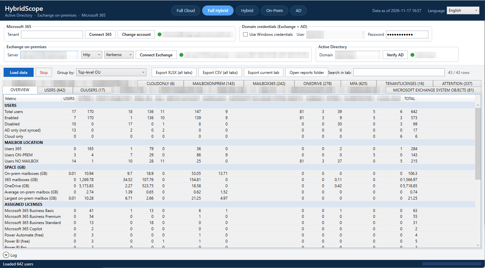
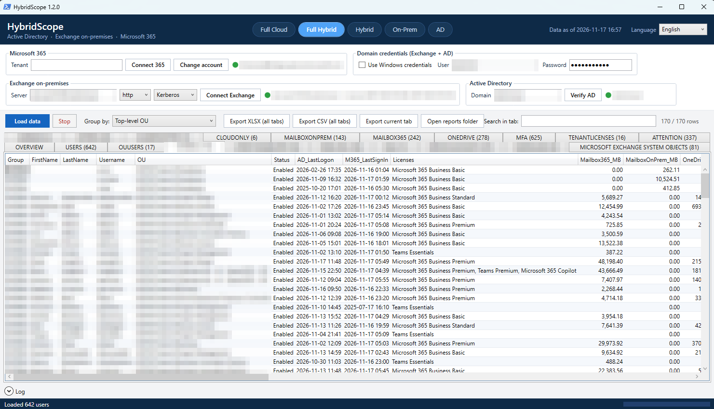
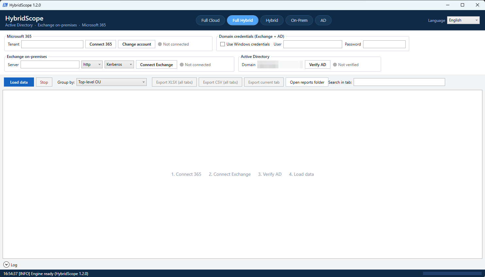
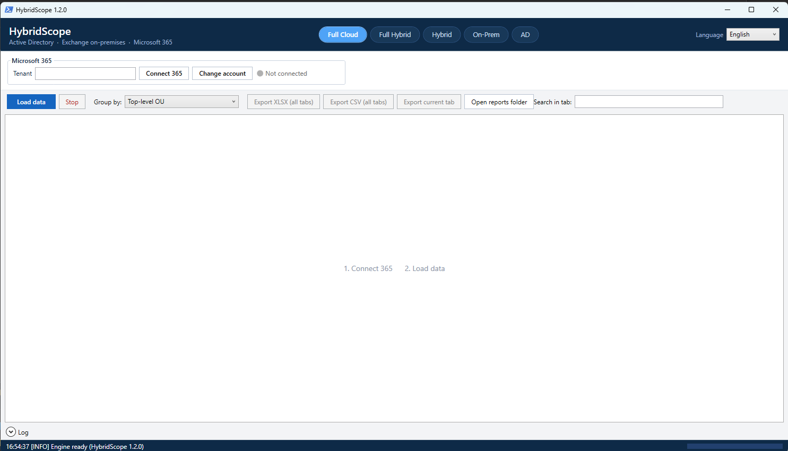
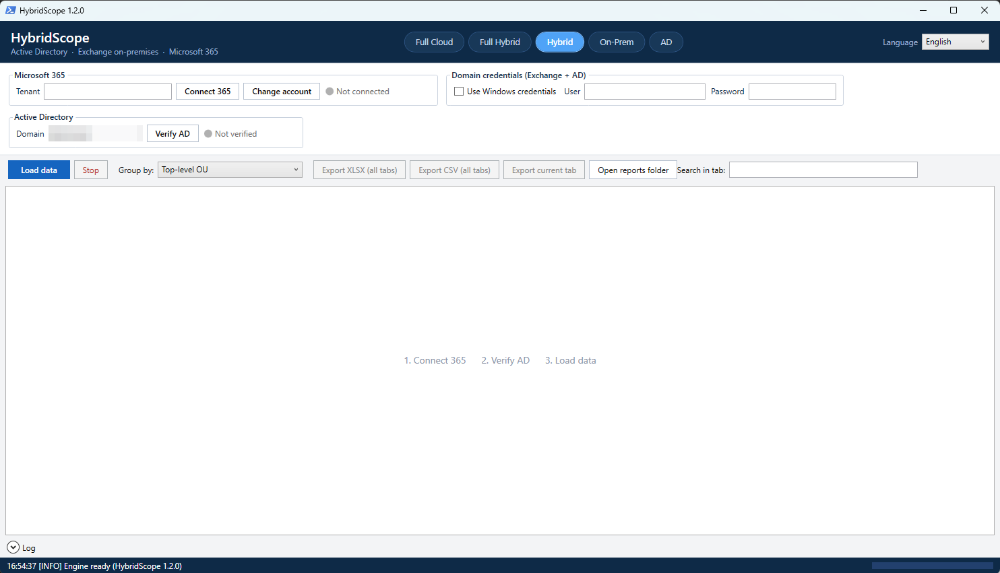
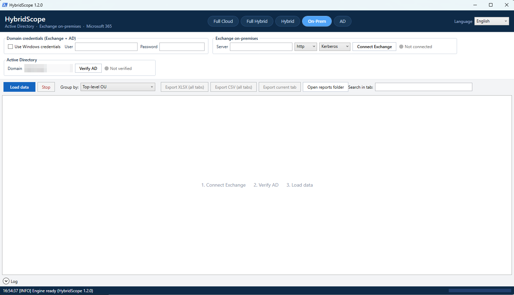
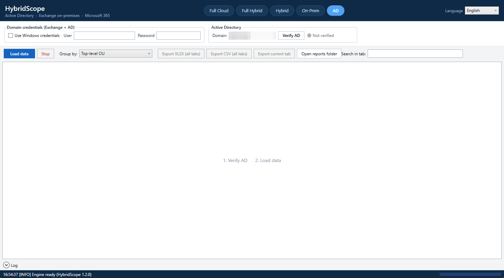
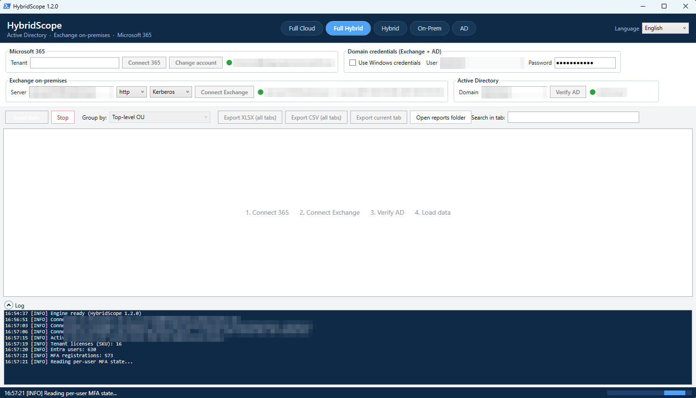

<div align="center">


# HybridScope

**One view of your hybrid identities and their PCs: Active Directory + Exchange on-premises + Microsoft 365 + Microsoft Defender.**

Who is on-prem and who is already in the cloud, how much space every mailbox uses, who has a license, who has MFA, who hasn't signed in for months, and which PCs have vulnerabilities to fix: in one window, exportable to Excel.

[](https://github.com/sponsors/Thonno)
[](https://buymeacoffee.com/aascione956)
[](https://github.com/Thonno/hybridscope/stargazers)


**English** · [Italiano](README.it.md) · [Website](https://thonno.github.io/hybridscope/)



</div>

---

## Contents

1. [What HybridScope does](#what-hybridscope-does)
2. [Quick start](#quick-start)
3. [**Microsoft Defender (security)**](#microsoft-defender-security) ← one-time setup needed for the security tabs
4. [Using the GUI](#using-the-gui)
5. [Command line and scheduled reports](#command-line-and-scheduled-reports)
6. [Tabs and columns](#tabs-and-columns)
7. [Configuration (config.json)](#configuration-configjson)
8. [Permissions](#permissions)
9. [Troubleshooting](#troubleshooting)
10. [FAQ](#faq) · [Roadmap](#roadmap) · [Support the project](#support-the-project) · [License](#license)

---

## What HybridScope does

A free PowerShell tool for Windows with an RVTools-style window. **It only reads**: it never changes anything in AD, Exchange, Microsoft 365 or Defender.

| Source | What it reads |
|---|---|
| **Active Directory** | Users, OUs, enabled / disabled, last logon, last password change, groups |
| **Exchange Server on-premises** | Mailboxes: size, items, database, quota, last access; remote mailboxes already migrated |
| **Microsoft 365** (Microsoft Graph) | Licenses, last sign-in, Exchange Online, OneDrive, MFA registration and methods, per-user MFA |
| **Microsoft Defender** (Business / Endpoint) | For the users with a Defender license: their PCs, risk, antivirus, vulnerabilities (CVE), missing KBs, software to update or out of support, weak configurations |

What you get out of it:

- **Reliable mailbox location**: `ON-PREM` / `365` / `NO MAILBOX` from Exchange and Graph, never guessed from the size.
- **Real MFA status**: registered or not, which methods, the default one, the legacy per-user state.
- **Security per user and PC** (Defender): what to patch, on which PC, with priority to exploitable vulnerabilities. See [Microsoft Defender](#microsoft-defender-security).
- **AD ↔ Entra ID sync check**: broken `ImmutableId`, accounts that will soft-match or conflict at the next sync, provisioning errors.
- **Overview** per OU with totals and an **Attention** list: mailboxes to migrate, licensed users without MFA, licenses on disabled accounts, inactive or unsynced accounts, sync problems, exploitable vulnerabilities.
- **User card**: double-click a user to see AD, mailboxes, OneDrive, MFA, licenses, groups and roles in one window; for users with a PC in Defender, a second panel lists what to fix on each PC (KBs, software updates, software out of support, weak configurations) with severity and exploit.
- **Export** to formatted Excel or CSV: everything, a preset or only the columns you tick. **Open a saved report** later without connecting to anything.
- **Scheduled reports** (`-Auto`) and **command line** (`-Only MFA`, `-PassThru`...).
- **Five infrastructure modes** (Full Cloud, Full Hybrid, Hybrid, On-Prem, AD), works from a PC outside the domain, English / Italian interface.

<details>
<summary><b>Screenshots</b></summary>

**Users**: one row per user, AD + Exchange + Microsoft 365 merged.



| Full Hybrid | Full Cloud |
|---|---|
|  |  |
| **Hybrid** | **On-Prem** |
|  |  |
| **AD** | **Connected, loading** |
|  |  |

<sub>Sensitive data (users, domains, servers, OU names) is blurred.</sub>
</details>

---

## Quick start

**Requirements**: Windows 10 / 11 or Windows Server 2016+, Windows PowerShell 5.1 (built into Windows). The modules `Microsoft.Graph.Authentication`, `ImportExcel` and `ActiveDirectory` (RSAT) are offered for installation at start-up. Last sign-in and the MFA report need **Entra ID P1** (included in Business Premium, E3, E5); without it HybridScope uses a slower method.

1. **Download** the [latest release](https://github.com/Thonno/hybridscope/releases/latest) and extract it to a local folder, e.g. `C:\HybridScope` (not OneDrive or Desktop).
2. **Allow local scripts**, once, from PowerShell:
   ```powershell
   Set-ExecutionPolicy -Scope CurrentUser RemoteSigned
   Get-ChildItem C:\HybridScope -Recurse | Unblock-File
   ```
3. **Start** it: double-click **`Start-HybridScope.cmd`** (or `.\HybridScope.ps1` from PowerShell). Accept the installation of the missing modules.
4. Pick your **infrastructure** at the top, **connect** (Microsoft 365, Exchange, AD) and press **Load data**. Step-by-step guide: [Using the GUI](#using-the-gui).
5. Want the **security tabs** (Defender)? Do the [one-time setup](#microsoft-defender-security) first.

`config.json` is created next to the script on first run; `config.sample.json` lists every option.

---

## Microsoft Defender (security)

> **One-time setup required.** The security tabs need two things that HybridScope cannot do for you: **the PCs must be onboarded to Microsoft Defender**, and an administrator must **register the HybridScope app** in Entra ID (5 minutes, script or by hand). Without them HybridScope works as usual, just without the security tabs.

### What you get

With the **Defender** box ticked, **Load data** also reads **Microsoft Defender for Business / Defender for Endpoint** (included in Microsoft 365 Business Premium, E3 / E5 and the Defender add-ons). Only **users with a Defender license** are reported: users with other licenses (e.g. Teams Essentials, Business Standard) and the PCs used only by them are left out.

| Tab | Content |
|---|---|
| **SECURITY** | One row per licensed user and PC: OS and build, last seen, sensor health, risk and exposure level, antivirus mode and updates, open alerts, vulnerabilities by severity, how many are exploitable, missing KBs, software to update, software out of support, weak configurations, notes. Users without a PC in Defender get one row that says so |
| **VULNERABILITIES** | One row per PC and CVE (from `DefenderMinSeverity`, default High): CVSS, exploit (public / verified / exploit kit), software and version, **fix** (KB to install, or software update with the recommended version). Exploitable first |
| **SECURITY_FIXES** | The to-do list, by priority: each KB, software update, software to replace and weak configuration, with how many PCs and CVEs it fixes and which PCs |
| **DEVICES_UNASSIGNED** | Optional (`DefenderUnassignedDevices`): onboarded devices not linked to a licensed user, with the reason. Useful to check the setup |

Also: a **SECURITY (DEFENDER)** section in the OVERVIEW, two ATTENTION categories (exploitable or critical vulnerabilities; Defender license without a PC), one section per PC in the user card, and the exposure score / Secure Score for devices in the report header.

### Before you start: checklist

| # | What | Who | How to check |
|---|---|---|---|
| 1 | Users have a license that includes Defender (Business Premium, E5, Defender for Business / Endpoint) | — | The log shows *N users with a Defender license* |
| 2 | **PCs are onboarded to Defender** | IT, once per PC | https://security.microsoft.com > **Assets** > **Devices**: the PC must be listed as *Onboarded* |
| 3 | The **HybridScope app** is registered in Entra ID | A Global Administrator, once per tenant | Entra > **App registrations** > *HybridScope* |
| 4 | Users of HybridScope have a Defender role, e.g. **Security Reader** | A Global Administrator, once per user | Entra > **Roles and administrators** |

**About step 2 (onboarding).** Defender knows only the PCs where its sensor is turned on. A license alone is not enough, and **a PC protected by another antivirus (e.g. Bitdefender) is not onboarded by itself**. Onboard it from https://security.microsoft.com > **Settings** > **Endpoints** > **Onboarding** (local script for a few PCs, Group Policy, Configuration Manager or Intune). The other antivirus can stay: on an onboarded PC Microsoft Defender Antivirus goes into *passive mode* and Defender still collects vulnerabilities, software and configurations. HybridScope then shows the antivirus as *Passive*.

### How the sign-in works

Microsoft lets programs read Defender only through an **app registration** of your own tenant (the generic app used by *Connect 365* cannot). So HybridScope uses an app called **HybridScope**, registered **once for the whole tenant**:

- **in the GUI: browser sign-in.** When you press **Load data** with **Defender** ticked, the browser asks you to sign in with **your own account** (usually it closes by itself, because you are already signed in). No certificate, no secret, nothing to copy between PCs. Everyone sees only what their Defender role allows;
- **in scheduled reports (`-Auto`): certificate.** Nobody is there to sign in, so the same app uses a certificate (see [Scheduled reports](#scheduled-reports--auto)). Not needed if you only use the GUI.

The app only has **read** permissions. Its ID (`ClientId`) is not a secret: copy `config.json` to the other PCs to use HybridScope there. To revoke everything, delete the app in Entra.

### Register the app: option A, with the script

From PowerShell, as a **Global Administrator**, in the HybridScope folder:

```powershell
.\tools\New-HybridScopeApp.ps1 -TenantId contoso.onmicrosoft.com -Defender
```

It signs in (browser), creates the **HybridScope** app (or updates the one already in `config.json`), adds the platform *Mobile and desktop applications* with redirect `http://localhost`, the delegated Defender permissions and the admin consent, and writes `TenantId`, `ClientId` and `Defender = true` into `config.json`. It creates no certificate. If Defender has never been opened in the tenant, open https://security.microsoft.com once as an administrator and run it again.

### Register the app: option B, by hand

1. https://entra.microsoft.com, as a Global Administrator > **Identity** > **Applications** > **App registrations** > **New registration**.
2. **Name** `HybridScope`; **Supported account types** *Accounts in this organizational directory only*; **Redirect URI**: platform **Public client/native (mobile & desktop)**, value `http://localhost`. **Register**.
3. In **Overview** copy the **Application (client) ID** and the **Directory (tenant) ID**.
4. **API permissions** > **Add a permission** > tab **APIs my organization uses** > **WindowsDefenderATP** > **Delegated permissions** > tick `Machine.Read`, `User.Read.All`, `Vulnerability.Read`, `Software.Read`, `SecurityRecommendation.Read`, `Alert.Read`, `Score.Read` > **Add permissions**.
5. **Grant admin consent for &lt;tenant&gt;** > **Yes**. Every permission must show a green *Granted*.
6. In HybridScope's `config.json` (start HybridScope once if it does not exist yet):
   ```json
   "TenantId": "contoso.onmicrosoft.com",
   "ClientId": "<Application (client) ID>",
   "Defender": true
   ```
7. Give the HybridScope users a Defender role, e.g. **Security Reader** (**Identity** > **Roles & admins**).

### Run it

**GUI**: connect as usual, tick **Defender** (next to *Connect 365*), choose **FULL** in *Export content*, press **Load data** and sign in when the browser asks. **Command line**: `-Auto` reads Defender when `Defender = true` (with a certificate, see [Scheduled reports](#scheduled-reports--auto)).

The log tells you what happened, for example:

```
Defender: 42 onboarded devices (3 discovered, not onboarded)
Defender: 42 devices -> 38 used by users with a Defender license, 2 only by users without it, 0 only by accounts not found in AD / Entra, 2 without interactive logons
Defender: 55 users with a Defender license, 38 devices, 17 users without a device (95 s)
```

The Defender API allows 100 calls per minute and HybridScope reads the logged-on users with one call per PC: allow about 1 minute every 90 PCs.

### How PCs are linked to users

- Defender records **who logs on** to each onboarded PC. HybridScope matches those accounts with the users it already reads: `DOMAIN\user` with the AD account, `AzureAD\name` (PCs joined to Entra ID) with the UPN or the display name. When Defender has no logons for a PC joined to Entra ID, its **Entra owner / registered user** is used (Graph `Device.Read.All`). As a last resort (`DefenderMatchByName`) the user is guessed from the **PC name** when it contains the username or a surname found only once (e.g. `NET-FBACCI`); those rows get a note. **Intune and Entra join are not needed.**
- The **main** user of a PC is the one with the latest interactive logon; the others are *Other*. Logons older than `DefenderDays` (default 30, counted from the PC's last contact) are ignored.
- The **license filter** checks the service plans of the user's licenses (`DefenderLicensePlans`: `MDE_SMB` = Defender for Business, `MDE_LITE` = Defender for Endpoint P1, `WINDEFATP` = P2), not the license name: add-ons and E3 / E5 are included automatically.

### The SECURITY tab is empty or incomplete

| What you see | Why | What to do |
|---|---|---|
| *No device in Defender with a logon of this user* for everyone, few onboarded devices in the log | The PCs are not onboarded to Defender (e.g. protected only by another antivirus) | Onboard them (checklist, step 2) |
| Log: *N without interactive logons* | Defender has no logged-on users for those PCs (just onboarded: wait a few hours; servers) and no Entra owner was found | Set `DefenderUnassignedDevices = true` (with HybridScope closed, or it is overwritten) and check the *Accounts* column in DEVICES_UNASSIGNED; reconnect with **Change account** to grant `Device.Read.All` |
| Log: *N only by users without it* | Those PCs are used by people without a Defender license | Expected: they are left out on purpose |
| Log: *N only by accounts not found in AD / Entra (…)* | The logon names do not match any user | Set `DefenderUnassignedDevices = true` to see the accounts in DEVICES_UNASSIGNED and open an issue with an example |
| *access denied by Defender (403)* | Missing Defender role, or admin consent not granted | Checklist, steps 3-4 |
| *ClientId missing in config.json* | App not registered on this PC | Option A or B, or copy `config.json` from a PC where it works |
| *Defender … not read: …* | That part is not available with your plan or permissions | The rest of the report is written; nothing to do unless you need that part |
| AADSTS50011 (redirect URI) in the browser | `http://localhost` missing in the app | Option B, step 2 |

---

## Using the GUI

1. **Infrastructure**: click your environment at the top of the window. Only the panels you need are shown.

   | Button | Sources | What you get |
   |---|---|---|
   | **Full Cloud** | Microsoft 365 | Users, licenses, Exchange Online, OneDrive, MFA, last sign-in |
   | **Full Hybrid** | Microsoft 365 + Exchange on-prem + AD | Everything: on-prem vs 365 location, mailboxes on both sides, MFA, licenses, AD data |
   | **Hybrid** | Microsoft 365 + AD | AD users merged with their cloud accounts |
   | **On-Prem** | Exchange on-prem + AD | AD users with their on-prem mailboxes |
   | **AD** | Active Directory | Users, OUs, status, last logon, password age |

2. **Microsoft 365**: optionally type the tenant (`contoso.onmicrosoft.com`), press **Connect 365** and sign in in the browser. The first time an administrator consents to the read-only permissions. Wrong account? **Change account**. Tick **Defender** for the security tabs ([setup](#microsoft-defender-security)).
3. **Domain credentials**: keep **Use Windows credentials** on a domain-joined PC; otherwise untick it and type `john@contoso.local`, `CONTOSO\john` or just `john`. Used for Exchange and AD; the password is never saved.
4. **Exchange on-premises**: internal FQDN of an Exchange server (e.g. `exch01.contoso.local`), `http` + `Kerberos` (recommended), `https` only with a valid certificate, `local` on the Exchange server itself. **Connect Exchange**.
5. **Active Directory**: check the domain, **Verify AD**.
6. **Group by**: *Top-level OU*, *Parent OU* (usually the most useful), *No grouping* or *Custom rules* (`GroupRules`). No OU mapping by hand.
7. **Export content** (what the export will contain), then **Load data**. Progress appears in the **Log**; **Stop** cancels.

   - **FULL**: every tab and every column (needed for Defender).
   - **A preset**: *Sign-ins and inactivity*, *Licenses*, *Mailbox migration*, *MFA security*, *Directory*.
   - **Custom**: **Columns...** and tick only what you need; **Save as preset...** keeps it.
   - Options: one sheet per group, include OVERVIEW, enabled accounts only.
   - **Read only the data needed** (default on): with a preset / Custom, only the data those columns need is read, so the load is much faster; the top bar shows **PARTIAL LOAD**.

8. **Work with the data**: search box (filters the current tab), sortable columns, copy with headers, **double-click a user** in any tab for the user card, **Export XLSX...** / **Export CSV...**, or export only the current tab.
9. **Later**: **File > Open report** (Ctrl+O) or drag an `.xlsx` / CSV folder onto the window to browse a saved report without connecting, e.g. the daily `HybridScope_LATEST.xlsx`.

Language: top-right menu (restart required). **Help > Check for updates** compares with the latest release.

---

## Command line and scheduled reports

### From PowerShell

Every run without the window uses `config.json`. Full help: `Get-Help .\HybridScope.ps1 -Full`.

| Parameter | What it does |
|---|---|
| `-Auto` | Full report for the configured `Mode`, written to `OutputFolder` (plus `history.csv` and `HybridScope_LATEST.xlsx`). Includes the Defender tabs when `Defender = true` |
| `-Only <dataset>` | One dataset only: `MFA`, `Licenses`, `Mailbox365`, `OneDrive`, `MailboxOnPrem` or `Sync`. Only the sources it needs are contacted |
| `-PassThru` | Objects instead of files: the `-Only` rows, or one merged row per user (values in English) |
| `-Mode <mode>` | Overrides `Mode` for this run: `Cloud`, `FullHybrid`, `Hybrid`, `OnPrem`, `AD` |
| `-ExportPreset <name>` | `Full` (default), `Access`, `Licenses`, `Migration`, `MFA`, `Directory`, `Custom` or one of your presets |
| `-Columns <list>` | Only these user columns, in this order, e.g. `Username,AD_LastLogon,M365_LastSignIn` |
| `-ConfigPath <file>` | Another configuration file, e.g. one per tenant |

With `AuthMode = Interactive` (default) the browser sign-in opens once (twice with Defender); with `Certificate` there is no prompt. Exit code `0` = success, `1` = error (details in `OutputFolder\logs`).

```powershell
# full report now, like Load data with FULL
.\HybridScope.ps1 -Auto

# MFA status only, to Excel (AD and Exchange are not touched)
.\HybridScope.ps1 -Only MFA

# users without MFA, straight to CSV
.\HybridScope.ps1 -Only MFA -PassThru | Where-Object MFA_Registered -eq 'No' | Export-Csv .\no-mfa.csv -NoTypeInformation

# what will go wrong at the next AD -> Entra ID sync
.\HybridScope.ps1 -Only Sync -PassThru | Where-Object Category -notlike '0 *' | Format-Table Category, Username, UPN, Details -Wrap

# only username, last AD logon and last Microsoft 365 sign-in
.\HybridScope.ps1 -Auto -Columns Username,AD_LastLogon,M365_LastSignIn

# Microsoft 365 only, without editing config.json
.\HybridScope.ps1 -Auto -Mode Cloud

# on-prem mailboxes still to migrate, largest first
.\HybridScope.ps1 -PassThru | Where-Object Location -eq 'ON-PREM' | Sort-Object MailboxOnPrem_MB -Descending
```

### Scheduled reports (-Auto)

A daily report with nobody signed in needs the HybridScope app **with a certificate**.

1. **Certificate and permissions**, once, as a Global Administrator, **logged on to Windows with the account that will run the task** (the certificate is stored in its certificate store):
   ```powershell
   .\tools\New-HybridScopeApp.ps1 -TenantId contoso.onmicrosoft.com
   ```
   It creates the certificate, adds it to the HybridScope app (the one in `config.json`, or a new one), grants the read-only application permissions and sets `AuthMode = Certificate`. With `Defender = true` the app also gets the application Defender permissions, so `-Auto` writes the security tabs too. Use `-Store LocalMachine` (elevated) to share the certificate between accounts of the same PC.
2. **Daily task**, from an elevated PowerShell:
   ```powershell
   .\tools\Register-HybridScopeTask.ps1 -RunAs CONTOSO\svc-hybridscope -At 06:40
   ```
3. Every run writes to `OutputFolder`: `HybridScope_<date>.xlsx` (with a preset `HybridScope_<preset>_<date>.xlsx`), `HybridScope_LATEST.xlsx` (always the latest, handy to share), `history.csv` (HISTORY tab) and `logs\`.

Run it by hand: `powershell -File .\HybridScope.ps1 -Auto`. The GUI keeps using the browser sign-in; the certificate is used only by `-Auto`.

<details>
<summary><b>Optional: build an .exe</b></summary>

```powershell
.\tools\Build-Exe.ps1
```
Creates `HybridScope.exe` with [PS2EXE](https://github.com/MScholtes/PS2EXE) (installed if missing), with the HybridScope icon and version. It must stay next to `tools\` and `config.json`. The exe **contains** the script: rebuild it after every update. Antivirus engines often flag PS2EXE executables as false positives: sign it, or just use `Start-HybridScope.cmd`.
</details>

---

## Tabs and columns

| Tab | Content |
|---|---|
| **OVERVIEW** | Counts per group and **TOTAL**: users, mailbox location, space (GB), licenses, MFA, inactivity, security |
| **USERS** | All users, one row each |
| *one tab per group* | Users of each OU / group (`GroupBy`, `GroupRules`) |
| **OTHER** / **CLOUD_ONLY** | AD users that match no rule / Entra users without an AD account |
| **MAILBOX_ONPREM** | On-prem mailboxes: type, database, size, items, deleted items, last access, quota |
| **MAILBOX_365** | Exchange Online mailboxes (Microsoft usage report) |
| **ONEDRIVE** | OneDrive: used space, quota, files, last activity |
| **MFA** | Every Entra member: registered, capable, default method, methods, per-user state, SSPR, admin |
| **TENANT_LICENSES** | Purchased / assigned / available / suspended per SKU |
| **SYNC** | AD ↔ Entra ID sync check (modes with AD and Microsoft 365) |
| **SECURITY**, **VULNERABILITIES**, **SECURITY_FIXES** | Microsoft Defender, see [Microsoft Defender](#microsoft-defender-security) |
| **ATTENTION** | To-do list: mailboxes to migrate, licensed without MFA, licensed but disabled, inactive, not synced, sync problems, exploitable vulnerabilities, Defender license without a PC |
| **HISTORY** | One row per `-Auto` run, to follow the trends |

<details>
<summary><b>User columns</b> (USERS and group tabs)</summary>

| Column | Description |
|---|---|
| Group | Group / OU tab of the user |
| FirstName, LastName, Username | From AD (or Entra for cloud-only users) |
| OU | Path of the user's OU, e.g. `CONTOSO\Sales\Employees` |
| Status | Enabled / Disabled |
| AD_LastLogon | `lastLogonTimestamp`, replicated, accurate to about 14 days |
| M365_LastSignIn | Latest interactive or non-interactive sign-in |
| Licenses | Friendly license names (`LicenseNames`) |
| Mailbox365_MB / MailboxOnPrem_MB / OneDrive_MB | Used space in MB. Empty when Microsoft does not report it |
| PasswordLastSet | Last password change (AD) |
| **Location** | `365`, `ON-PREM` or `NO MAILBOX` (below) |
| MailboxType, MailboxSource | Mailbox type and where the location comes from |
| MFA_Status, MFA_DefaultMethod, MFA_Methods | Configured / Not configured / Not in Entra, default and registered methods |
| MFA_PerUser | Legacy per-user MFA: `disabled` / `enabled` / `enforced` |
| UPN, Origin | Microsoft 365 UPN; AD synced / AD only / AD + cloud (not linked) / Cloud only / Guest |
| SyncIssues, Notes | Sync problems (SYNC tab) and anomalies, e.g. "Licensed without MFA" |

**Location**: a mailbox on Exchange on-prem → **ON-PREM**; a `RemoteMailbox` (migrated) → **365**; Exchange Online provisioned or in the usage report → **365**; otherwise **NO MAILBOX**.
</details>

<details>
<summary><b>Sync check categories</b> (SYNC tab)</summary>

The SYNC tab compares AD with Entra ID through the **source anchor**, as Entra Connect and Cloud Sync do: `ms-DS-ConsistencyGuid` (or `objectGUID`) in AD, `onPremisesImmutableId` in Entra.

| Category | What it means |
|---|---|
| 0 - Directory sync status | When the last sync ran; flagged when older than `SyncStaleHours` or sync is off |
| 1 - ImmutableId differs from the AD anchor | Entra is linked to another object; usually the AD account was deleted and recreated |
| 2 - Synced account not found in AD | Synced from the domain / OU you read, but no AD account has its anchor |
| 3 - Cloud account with a leftover ImmutableId | An AD account with that anchor would take it over |
| 4 - Will soft-match a cloud account | Same UPN or primary SMTP: merged at the first sync |
| 5 - Conflicts with a cloud account | Same UPN / SMTP but another `ImmutableId`: the sync will fail |
| 6 - Provisioning error in Entra | Duplicate `proxyAddresses`, UPN... |
| 7 - Entra UPN fell back to onmicrosoft.com | The AD UPN suffix is not a verified domain |
| 8 - Same anchor on more than one AD account | Copied or restored objects |

Accounts from another domain / forest or outside `SearchBase` are not reported as missing. With a custom source anchor (e.g. `employeeID`) categories 1 and 2 are skipped, with a warning.
</details>

<details>
<summary><b>Security columns</b> (SECURITY tab)</summary>

| Column | Description |
|---|---|
| Device, UserRole | PC name; *Main* (latest interactive logon) or *Other* |
| DeviceLastLogon, DeviceUsers | Last logon of this user on the PC; how many accounts log on to it |
| OS, OsBuild, LastSeen | Operating system, build, last contact with Defender |
| Sensor, Risk, Exposure | Sensor health; Defender risk and exposure level |
| Antivirus | *Active* / *Passive* / *EDR block*, up to date or not |
| Alerts | Open alerts (last 90 days) |
| Vuln_Critical / High / Medium / Low, Exploitable | Vulnerabilities by severity, and how many have a known exploit |
| MissingKB, AppsToUpdate, EOL_Software, ConfigIssues | What to install, update, replace, and weak configurations |
| Notes | PC not seen for a while, OS out of support, domain admins logging on, alert titles |
</details>

---

## Configuration (config.json)

Created on first run; most values are also set from the window. `config.sample.json` lists them all.

| Key | Default | Description |
|---|---|---|
| **General** | | |
| `Language` | system | `en` or `it` |
| `Mode` | `FullHybrid` | `Cloud`, `FullHybrid`, `Hybrid`, `OnPrem` or `AD` (start-up mode, and mode of `-Auto`) |
| `OutputFolder` | `Documents\HybridScope` | Reports, `history.csv` and logs |
| `RetentionDays` | `90` | `-Auto` deletes older reports and logs (0 = never) |
| **Microsoft 365 and the HybridScope app** | | |
| `TenantId` | *(empty)* | Tenant domain or ID; empty = tenant of the signed-in account |
| `AuthMode` | `Interactive` | `Interactive` (browser) or `Certificate` (`-Auto`) |
| `ClientId` | *(empty)* | ID of the HybridScope app: needed for Defender and for `-Auto` with a certificate |
| `CertificateThumbprint` | *(empty)* | Certificate of the app, only for `-Auto` |
| `IncludePerUserMfaState` | `true` | Legacy per-user MFA state (one Graph call per user) |
| `IncludeGuests` | `false` | Include Entra guests |
| **Active Directory and Exchange** | | |
| `DomainFqdn` | `%USERDNSDOMAIN%` | AD domain; empty skips AD |
| `SearchBase` | *(empty)* | Limit AD to an OU |
| `UseWindowsCredentials`, `DomainUser` | `true`, empty | Last values used in the GUI (never the password) |
| `ExchangeServer` | *(empty)* | Internal FQDN of an Exchange server; empty skips Exchange |
| `ExchangeProtocol`, `ExchangeAuth` | `http`, `Kerberos` | `http` / `https` / `local`; `Kerberos` / `Negotiate` / `Basic` |
| `ExchangeSkipCertCheck` | `false` | Skip certificate checks with `https` |
| **Report** | | |
| `InactiveDays`, `PasswordAgeDays` | `90`, `365` | Inactivity and old-password thresholds |
| `SyncStaleHours` | `3` | SYNC: flag the directory sync when the last cycle is older |
| `LicenseFilter`, `LicenseNames` | `All`, common SKUs | Show all SKUs or only the mapped ones; friendly names `"SKU": "Name"` |
| `GroupBy`, `GroupRules` | `TopLevelOU`, `[]` | `TopLevelOU`, `ParentOU`, `None` or `Rules`; rules `{ "Group": "EMPLOYEES", "Match": "OU=Employees," }` (first match wins) |
| `UnmappedGroup`, `CloudOnlyGroup` | `OTHER`, `CLOUD_ONLY` | Names of those groups |
| **Export** | | |
| `ExportPreset`, `ExportColumns` | `Full`, `[]` | Choice in *Export content*; Custom columns (English names) |
| `ExportGroupSheets`, `ExportOverview`, `ExportEnabledOnly` | `false` | One sheet per group, include OVERVIEW, enabled accounts only |
| `ExportPresets` | `{}` | Your presets, saved by the export window |
| `ExportFastLoad` | `true` | With a preset / Custom read only the data needed |
| `AutoExportPreset` | `Full` | Content of the `-Auto` report |
| **Microsoft Defender** | | |
| `Defender` | `false` | Read Defender (GUI box **Defender**); only with FULL content. Edit `config.json` with HybridScope closed: the window saves its own copy |
| `DefenderLicensePlans` | `MDE_SMB`, `MDE_LITE`, `WINDEFATP` | Service plans that put a user in the security tabs |
| `DefenderDays` | `30` | Logons older than this (from the PC's last contact) are ignored; PCs not seen for longer are flagged |
| `DefenderMinSeverity` | `High` | Lowest severity listed in VULNERABILITIES (`Critical`, `High`, `Medium`, `Low`); counts and fixes use all |
| `DefenderUnassignedDevices` | `false` | Also list devices not linked to a licensed user (DEVICES_UNASSIGNED), with the reason |
| `DefenderMatchByName` | `true` | Last resort: link a PC without logons or Entra owner to the user whose username or unique surname is in the PC name |

<details>
<summary><b>Examples</b></summary>

```json
"GroupBy": "Rules",
"GroupRules": [
  { "Group": "DISABLED",  "Match": "OU=Disabled Users," },
  { "Group": "EMPLOYEES", "Match": "OU=Employees," }
],
"LicenseFilter": "MappedOnly",
"LicenseNames": {
  "O365_BUSINESS_PREMIUM": "M365 BUSINESS STANDARD",
  "SPB": "M365 BUSINESS PREMIUM"
}
```
Keep the trailing comma in `Match`: it prevents partial matches such as `OU=EmployeesOld`.
</details>

---

## Permissions

HybridScope only **reads**. Everyday use does not need Domain Admin or Global Admin; a Global Administrator is needed only once, for the consent and the HybridScope app.

| System | Minimum |
|---|---|
| Active Directory | Any domain user |
| Exchange on-premises | **View-Only Organization Management** and `RemotePowerShellEnabled = $true` |
| Microsoft 365 | **Global Reader**, plus a one-time admin consent |
| Microsoft Defender | A Defender role such as **Security Reader**, plus the HybridScope app |

- **Microsoft Graph** (delegated in the GUI, application for `-Auto`): `User.Read.All`, `AuditLog.Read.All`, `Reports.Read.All`, `UserAuthenticationMethod.Read.All`, `Organization.Read.All`, `Policy.Read.All`. The GUI also asks for `GroupMember.Read.All` and `RoleManagement.Read.Directory` (group and role names in the user card) and `Device.Read.All` (Entra owner of a PC, for Defender); without consent it connects anyway and those details are left out.
- **Microsoft Defender** (WindowsDefenderATP, HybridScope app): delegated in the GUI `Machine.Read`, `User.Read.All`, `Vulnerability.Read`, `Software.Read`, `SecurityRecommendation.Read`, `Alert.Read`, `Score.Read`; application for `-Auto` the same with `.Read.All`.

---

## Troubleshooting

Defender problems: see [The SECURITY tab is empty or incomplete](#the-security-tab-is-empty-or-incomplete).

<details>
<summary><b>Connected to Microsoft 365 with the wrong account</b></summary>

Press **Change account**, then **Connect 365** again. If the browser picks the wrong account by itself, choose *Use another account* on the sign-in page.
</details>

<details>
<summary><b>"WorkgroupCannotUseKerberos" / "Cannot use Kerberos with implicit credentials"</b></summary>

The PC is not in the domain. Untick **Use Windows credentials** and enter `user@domain.local`. The PC must resolve the domain (internal DNS or VPN): `nslookup -type=SRV _kerberos._tcp.contoso.local`.
</details>

<details>
<summary><b>"The user name or password is incorrect" with Exchange</b></summary>

Check the exact sAMAccountName (`j.doe` vs `jdoe`) and use `user@domain.local`. Test outside HybridScope:

```powershell
$cred = Get-Credential user@contoso.local
$s = New-PSSession -ConfigurationName Microsoft.Exchange -ConnectionUri http://exch01.contoso.local/PowerShell/ -Authentication Kerberos -Credential $cred
Invoke-Command -Session $s -ScriptBlock { Get-ExchangeServer }
```
</details>

<details>
<summary><b>The browser asks for a certificate on https://server/powershell</b></summary>

Expected: `/PowerShell` is a WinRM endpoint, not a web page. Use `http` + `Kerberos` with the internal server name.
</details>

<details>
<summary><b>Microsoft 365 mailbox / OneDrive sizes are empty</b></summary>

Usage reports are anonymized: Microsoft 365 admin center > **Settings > Org settings > Reports** > untick *Display concealed user, group, and site names in all reports*. Reports can lag 24-48 hours.
</details>

<details>
<summary><b>ActiveDirectory module: error 0x800f0954</b></summary>

WSUS blocks Features on Demand. Install *RSAT: Active Directory Domain Services* from **Settings > System > Optional features**, or ask IT. HybridScope does not change Windows Update settings.
</details>

<details>
<summary><b>"running scripts is disabled" / "not digitally signed"</b></summary>

```powershell
Set-ExecutionPolicy -Scope CurrentUser RemoteSigned
Get-ChildItem C:\HybridScope -Recurse | Unblock-File
```
</details>

---

## FAQ

**Does it change anything?** No. Every call is read-only. The only exception is installing missing PowerShell modules, and only if you agree.

**Where is my data sent?** Nowhere. HybridScope talks only to your AD, your Exchange server, Microsoft Graph and the Defender API. Reports stay on your disk. **Help > Check for updates**, only when you click it, reads the latest release number from the public GitHub API.

**Do I need Intune for the security tabs?** No. The PCs must be onboarded to Defender; HybridScope finds their users from the logons Defender records.

**We use another antivirus (Bitdefender, ESET...). Does it work?** Yes, once the PCs are onboarded to Defender: Microsoft Defender Antivirus goes into passive mode and Defender still reports vulnerabilities and software.

**Without Microsoft 365, or without Exchange?** Yes: **On-Prem**, **Hybrid**, **Full Cloud** or **AD** mode.

**Just the MFA status, without the GUI?** `.\HybridScope.ps1 -Only MFA` (Excel) or `-Only MFA -PassThru` (objects).

## Roadmap

- [x] User card with groups and roles
- [x] Sync check: ImmutableId / source anchor, soft-match and conflicts
- [x] Security: Microsoft Defender devices, vulnerabilities and fixes for the users with a Defender license
- [ ] Shared / room mailboxes and distribution lists
- [ ] HTML summary after `-Auto`, to send by e-mail

## Support the project

HybridScope is free and open source and will stay that way. If it saves you time, you can leave a **one-time donation**: no subscription, no automatic renewal.

| | Amount | For |
|---|---|---|
| ☕ **Coffee** | $5 | A quick thank-you |
| 🍕 **Lunch** | $10 | You use it often and want it to stay free, read-only and open source |
| 🛠️ **Sysadmin** | $25 | It saved you hours: a migration, an audit, a license cleanup |
| 🏢 **Company** | $100 | Companies and MSPs using it in production. If you like, your company name can be listed under [Thanks](#thanks) |

[](https://github.com/sponsors/Thonno)
[](https://buymeacoffee.com/aascione956)
[](https://github.com/Thonno/hybridscope/stargazers)

Not in a position to donate? Leave a ⭐, open an issue with a bug or an idea, or recommend HybridScope to a colleague. Issues and pull requests are welcome; please open an issue before large changes.

## Thanks

Thanks to everyone who supports HybridScope.

**Companies and MSPs**

<!-- Add Company-tier sponsors who asked to be listed, one per line, e.g.:
- [Contoso Ltd](https://www.contoso.com)
-->
*No one yet: your company could be the first.*

## License

[MIT](LICENSE). HybridScope is an independent project and is not affiliated with, endorsed by or sponsored by Microsoft. Microsoft 365, Exchange, Entra ID, Defender and Active Directory are trademarks of the Microsoft group of companies.
